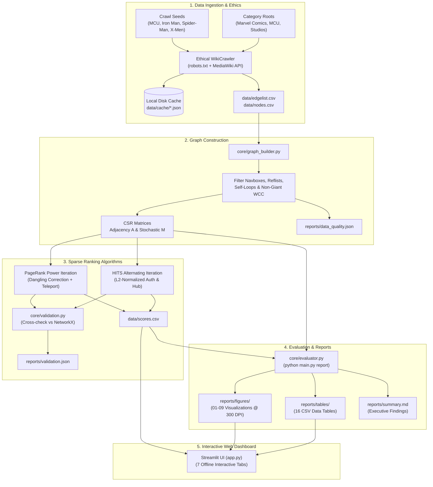

# Purpose and Project Overview

**MarvelGraphRank** is an academic research project designed to analyze the topological structure of the Marvel Comics and Marvel Cinematic Universe (MCU) knowledge graph as represented on English Wikipedia. By modeling Wikipedia articles as nodes and in-body hyperlinks as directed edges, the project quantifies the relative influence of different entities within this domain.

The core objective is to implement and validate foundational graph mining algorithms from scratch to measure how information and "importance" propagate through a specialized web of interconnected content.

## Project Goal

The primary goal is to measure entity influence using two distinct mathematical approaches:

1.  **PageRank**: This algorithm measures global recursive citation influence. It models the importance of a node based on the stationary distribution of a "random surfer" who traverses the graph with a damping factor (configured at $d = 0.85$ in `config.yaml`) and accounts for dangling nodes through uniform redistribution.
2.  **HITS (Hyperlink-Induced Topic Search)**: This algorithm identifies two distinct topological roles:
    *   **Authorities**: Prominent content pages that are frequently cited by other pages.
    *   **Hubs**: Directory or compilation pages that serve as high-quality curators of links to authoritative content.

## Technical Implementation

To ensure mathematical rigor and performance, the algorithms are not implemented using high-level graph libraries like NetworkX. Instead, they are implemented **from scratch** using:
*   `numpy` for numerical operations.
*   `scipy.sparse` (specifically CSR matrices) for efficient handling of the large, sparse adjacency and stochastic matrices.

### Validation and Accuracy
To prove the correctness of these custom implementations, the system performs a strict cross-validation against industry-standard `NetworkX` reference implementations (`nx.pagerank` and `nx.hits`). The accuracy is measured using:
*   **Mean Squared Error (MSE)**: Target precision of $MSE < 10^{-12}$.
*   **Spearman's $\rho$ (rho)**: Target correlation of $1.0000$.
*   **Kendall's $\tau$ (tau)**: Target correlation of $1.0000$.

## System Architecture

The project follows a linear pipeline from ethical data acquisition to interactive visualization:

## Key Components

### Wikipedia Crawling Pipeline
The `crawler/wiki_crawler.py` module implements an ethical, hybrid Breadth-First Search (BFS) approach. It adheres to Wikimedia's `robots.txt` policy and uses the MediaWiki API for efficient category expansion. To ensure politeness, it utilizes:
*   **Rate Limiting**: Randomized delays between requests.
*   **Domain Filtering**: Use of `dropped_namespaces` to exclude non-article content (e.g., User or Talk pages).
*   **Content Cleaning**: Use of `removed_selectors` to strip irrelevant HTML elements during parsing.

### Data State and Recovery
To support large-scale crawls that may be interrupted, the system maintains a state file at `data/cache/_crawl_state.json`. This file tracks visited articles and the current frontier, allowing the crawler to resume seamlessly. The primary outputs include:
*   `data/edgelist.csv`: The directed edges of the graph.
*   `data/nodes.csv`: Metadata for each entity.
*   `data/scores.csv`: The final calculated influence scores.

### Node Classification
Nodes are classified into semantic types (such as `character`, `film`, `tv_series`, or `person`) based on keyword-driven rules defined in `config.yaml`. This allows for nuanced analysis of how different types of entities influence one another.

### Deployment and Visualization
The results of the ranking process are exposed through a **Streamlit** application (`app.py`). This dashboard provides an interactive, offline environment to explore the ranked entities, view statistical figures, and examine data tables generated by the `evaluator.py` module.

## Source snapshot

Revision: `32f8ca14fe1a4de04497d11e942f9c7432d264d1`. Read 30 of 60 listed files. This guide does not claim exhaustive coverage.

- [README.md](https://github.com/santrupt29/cerebrorank/blob/32f8ca14fe1a4de04497d11e942f9c7432d264d1/README.md)
- [ETHICS.md](https://github.com/santrupt29/cerebrorank/blob/32f8ca14fe1a4de04497d11e942f9c7432d264d1/ETHICS.md)
