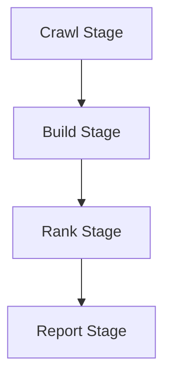

# Getting Started: CLI Execution

The `cerebrorank` project provides a unified Command Line Interface (CLI) via [main.py](https://github.com/santrupt29/cerebrorank/blob/32f8ca14fe1a4de04497d11e942f9c7432d264d1/main.py) to manage the data pipeline from extraction to final ranking.

## Project Overview

The goal of this project is to analyze the influence of entities within the Marvel Wikipedia link graph. By modeling the cross-referencing structure as a directed graph, the system implements PageRank and HITS (Hyperlink-Induced Topic Search) algorithms from scratch to measure entity influence.

## CLI Commands

All operations are executed using `python main.py [command]`. You can optionally provide a custom configuration file using the `--config PATH` flag.

### 1. Crawl (`crawl`)

The `crawl` command initiates the ethical hybrid Wikipedia crawler to gather data.

- **Command**: `python main.py crawl`
- **Purpose**: Runs the Wikipedia crawler to extract links and metadata from seed pages and category roots.
- **Options**:
    - `--pilot`: Runs a "smoke-test" version of the crawler that is limited to 30 nodes to verify the setup.
    - `--config PATH`: Specify a custom `config.yaml` file.

### 2. Build (`build`)

The `build` command processes the raw crawled data into a usable graph structure.

- **Command**: `python main.py build`
- **Purpose**: 
    - Loads crawled CSVs (`edgelist.csv` and `nodes.csv`).
    - Builds sparse CSR matrices (Adjacency matrix $A$ and Stochastic matrix $M$).
    - Filters for the non-giant Weakly Connected Component (WCC).
    - Generates a data-quality report saved to `reports/data_quality.json`.

### 3. Rank (`rank`)

The `rank` command executes the ranking algorithms and validates their accuracy.

- **Command**: `python main.py rank`
- **Purpose**: 
    - Executes the custom PageRank and HITS (Authority and Hub scores) implementations.
    - Cross-validates the results against the NetworkX reference implementations.
    - Saves the final influence scores to `data/scores.csv`.
    - Prints the top-10 entities by PageRank, HITS Authority, and HITS Hub scores to the console.

### 4. Report (`report`)

The `report` command generates final visualizations and analytical summaries.

- **Command**: `python main.py report`
- **Purpose**: 
    - Produces 9 high-resolution figures (300 DPI) in `reports/figures/`.
    - Generates 16 CSV data tables in `reports/tables/`.
    - Creates an executive summary in `reports/summary.md`.

---

## Pipeline Execution Flow

The following diagram illustrates the sequence of operations from raw data extraction to ranking:

## Full Pipeline Execution

For users who wish to run the entire pipeline sequentially, the `all` command is available (though marked as "coming" in the CLI entry point docstring in [main.py](https://github.com/santrupt29/cerebrorank/blob/32f8ca14fe1a4de04497d11e94de04497d11e942f9c7432d264d1/main.py), it is implemented as a sequence of `cmd_build`, `cmd_rank`, and `cmd_report`).

- **Command**: `python main.py all`

## Summary Table of CLI Usage

| Command | Stage | Primary Output |
| :--- | :--- | :--- |
| `crawl` | Stage 1 | `data/edgelist.csv`, `data/nodes.csv` |
| `build` | Stage 2 | `reports/data_quality.json` |
| `rank` | Stage 2 | `data/scores.csv`, `reports/validation.json` |
| `report` | Stage 4 | `reports/figures/`, `reports/summary.md` |

## Source snapshot

Revision: `32f8ca14fe1a4de04497d11e942f9c7432d264d1`. Read 30 of 60 listed files. This guide does not claim exhaustive coverage.

- [main.py](https://github.com/santrupt29/cerebrorank/blob/32f8ca14fe1a4de04497d11e942f9c7432d264d1/main.py)
- [README.md](https://github.com/santrupt29/cerebrorank/blob/32f8ca14fe1a4de04497d11e942f9c7432d264d1/README.md)
