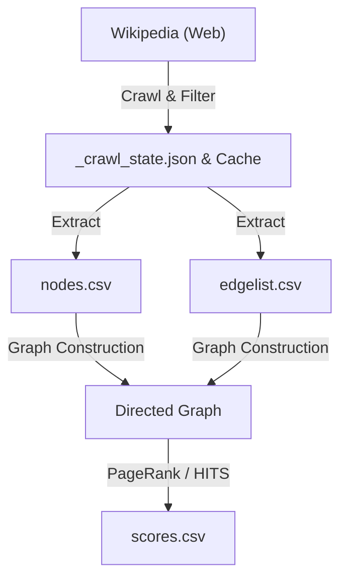

# Data State and Recovery

To ensure reliability during long-running web crawls and to provide a foundation for graph analysis, `cerebrorank` implements a structured data persistence strategy. This includes a resumable state mechanism for the crawler and specific CSV output files for downstream graph construction and ranking.

## Crawl Recovery and State Persistence

Web crawling is subject to network instability, rate-limiting (HTTP 429/503), and potential process interruptions. To mitigate data loss, the `WikiCrawler` implements a checkpointing system.

### The State File
The current progress of the crawler is persisted in a JSON state file, the location of which is defined in [config.yaml](https://github.com/santrupt29/cerebrorank/blob/32f8ca14fe1a4de04497d11e942f9c7432d264d1/config.yaml):

*   **Path:** `data/cache/_crawl_state.json` (as configured by `state_file`)
*   **Persistence Interval:** The crawler flushes its current state to disk every 10 nodes fetched ([crawler/wiki_crawler.py](https://github.com/santrupt29/cerebrorank/blob/32f8ca14fe1a4de04497d11e942f9c7432d264d1/crawler/wiki_crawler.py)).
*   **Resumption Behavior:** Upon initialization, the `WikiCrawler` attempts to load existing state via `_load_state()`. If a state file exists, the crawler resumes from the last saved progress, significantly reducing redundant network requests and time spent re-processing previously fetched nodes.

### Caching Mechanism
In addition to the state file, all individual HTTP responses are cached in the `cache_dir` ([config.yaml](https://github.com/santrupt29/cerebrorank/blob/32f8ca14fe1a4de04497d11e942f9c7432d264d1/config.yaml)). This ensures that re-runs of the crawler make zero network requests for items already present in the cache, adhering to ethical crawling practices and improving efficiency.

## Output Data for Analysis

Once the crawling phase is complete, the extracted data is structured into specific CSV files. These files serve as the primary inputs for the graph construction and ranking stages.

| File | Path (from [config.yaml](https://github.com/santrupt29/cerebrorank/blob/32f8ca14fe1a4de04497d11e942f9c7432d264d1/config.yaml)) | Description |
| :--- | :--- | :--- |
| `nodes.csv` | `data/nodes.csv` | Contains the metadata for all validated Wikipedia pages (nodes) discovered during the crawl. |
| `edgelist.csv` | `data/edgelist.csv` | Represents the directed links between nodes. An edge $u \to v$ is only recorded if both $u$ and $v$ are confirmed nodes in the system. |
| `scores.csv` | `data/scores.csv` | Stores the final influence scores (e.g., PageRank or HITS values) calculated for each node after the ranking algorithms have converged. |

### Data Flow Summary

The following sequence illustrates how data moves from raw web pages to analyzed ranking results:

*Note: The `edgelist.csv` is generated post-BFS to ensure that edges are only recorded between endpoints that have been successfully fetched and validated as part of the allowed node set ([crawler/wiki_crawler.py](https://github.com/santrupt29/cerebrorank/blob/32f8ca14fe1a4de04497d11e942f9c7432d264d1/crawler/wiki_crawler.py)).*

## Source snapshot

Revision: `32f8ca14fe1a4de04497d11e942f9c7432d264d1`. Read 30 of 60 listed files. This guide does not claim exhaustive coverage.

- [config.yaml](https://github.com/santrupt29/cerebrorank/blob/32f8ca14fe1a4de04497d11e942f9c7432d264d1/config.yaml)
- [crawler/wiki_crawler.py](https://github.com/santrupt29/cerebrorank/blob/32f8ca14fe1a4de04497d11e942f9c7432d264d1/crawler/wiki_crawler.py)
