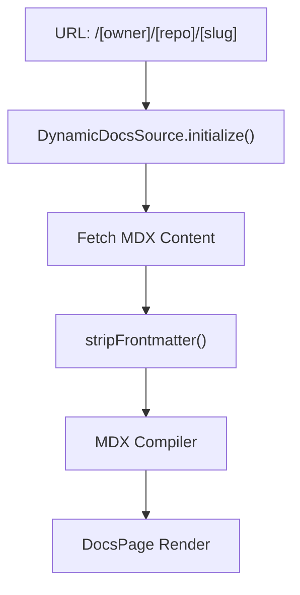

# Client Architecture

GitDex utilizes the Next.js App Router to provide a highly dynamic, documentation-driven user interface. The architecture is designed to fetch repository content on-demand and render it using an integrated MDX engine powered by Fumadocs.

## Routing Structure

The application employs dynamic segments to handle an arbitrary number of repositories. The core routing logic is contained within the `[owner]/[repo]` directory hierarchy.

### Dynamic Repository Routes
The routing is structured to capture both the repository identity and the specific documentation path:

- **Root Repository Path**: `/[owner]/[repo]`  
  When a user accesses the base repository URL (where the `slug` is empty), the application identifies the first available page via `DynamicDocsSource` and performs a redirect to that specific page's URL. If no pages are available, the `SyncingGuard` component is rendered.
  
- **Documentation Pages**: `/[owner]/[repo]/[[...slug]]`  
  Using optional catch-all segments (`[[...slug]]`), the application can render deeply nested documentation structures. The `slug` array represents the hierarchical path within the repository's documentation.

### Layout and Context
The repository-level layout ([client/src/app/[owner]/[repo]/layout.tsx](https://github.com/shinymack/gitdex/blob/fa39a44254f08e3d5bd99ae2467e2709092ef5f9/client/src/app/%5Bowner%5D/%5Brepo%5D/layout.tsx)) acts as a wrapper for all documentation pages within a specific repository. It performs two key functions:
1. **Content Rendering**: It renders the `children` provided by the page component.
2. **Global Assistant**: It injects the `AssistantModal` into the layout, passing the `owner` and `repo` parameters to ensure the AI chat context is tied to the specific repository being viewed.

## Documentation Rendering Engine

GitDex integrates **Fumadocs** to transform raw MDX content into interactive documentation.

### MDX Compilation Pipeline
The rendering process in `[[...slug]]/page.tsx` follows these steps:
1. **Data Fetching**: A `DynamicDocsSource` instance is initialized with the `owner` and `repo` to fetch the relevant content.
2. **Frontmatter Sanitization**: The `stripFrontmatter` function removes leading YAML frontmatter blocks to prevent parser errors during MDX compilation.
3. **TOC Generation**: The Table of Contents (TOC) is extracted directly from the processed MDX content using `getTableOfContents`.
4. **Compilation**: The sanitized MDX is passed to a custom `compiler` (configured via `client/lib/mdx-compiler`).
5. **Component Injection**: The compiled body is rendered within `DocsBody`, receiving custom components via `getMDXComponents` that are aware of the `owner`, `repo`, and `defaultBranch`.

### Configuration and Plugins
The MDX environment is configured through `client/next.config.mjs` and `client/source.config.ts`.

- **MDX Integration**: The `createMDX` function from `fumadocs-mdx/next` links the Next.js configuration to the documentation source configuration.
- **Mermaid Support**: The documentation engine includes `remarkMdxMermaid` within the `mdxOptions.remarkPlugins` configuration, allowing for the rendering of diagrams directly from MDX files.
- **Runtime Behavior**: The documentation pages are set to `force-dynamic` with `revalidate = 0` to ensure that content updates in the remote repository are reflected without stale cache issues.

## Source snapshot

Revision: `fa39a44254f08e3d5bd99ae2467e2709092ef5f9`. Read 50 of 105 listed files. This guide does not claim exhaustive coverage.

- [client/src/app/[owner]/[repo]/layout.tsx](https://github.com/shinymack/gitdex/blob/fa39a44254f08e3d5bd99ae2467e2709092ef5f9/client/src/app/%5Bowner%5D/%5Brepo%5D/layout.tsx)
- [client/src/app/[owner]/[repo]/[[...slug]]/page.tsx](https://github.com/shinymack/gitdex/blob/fa39a44254f08e3d5bd99ae2467e2709092ef5f9/client/src/app/%5Bowner%5D/%5Brepo%5D/%5B%5B...slug%5D%5D/page.tsx)
- [client/next.config.mjs](https://github.com/shinymack/gitdex/blob/fa39a44254f08e3d5bd99ae2467e2709092ef5f9/client/next.config.mjs)
- [client/source.config.ts](https://github.com/shinymack/gitdex/blob/fa39a44254f08e3d5bd99ae2467e2709092ef5f9/client/source.config.ts)
