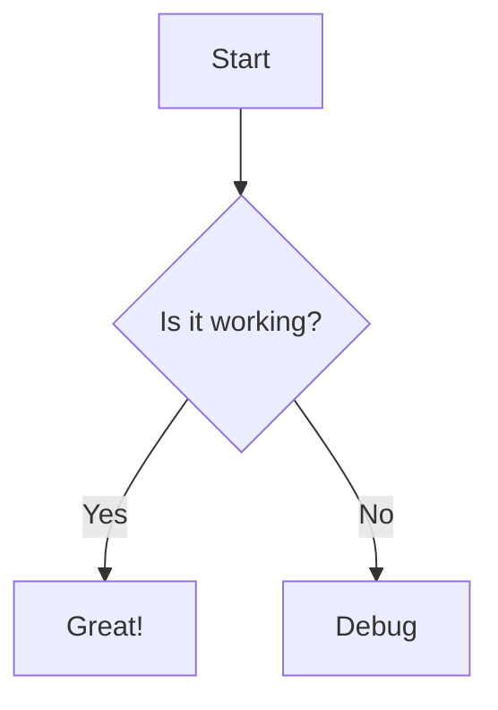

# Documentation Engine & MDX

GitDex utilizes **Fumadocs** to power its documentation rendering engine. This setup allows the application to transform MDX (Markdown with JSX) content into interactive, searchable, and visually rich documentation pages.

## Documentation Hierarchy

The documentation engine is configured to handle the structure of the repository's content. The integration is managed through the Next.js configuration, which uses the `createMDX` utility from Fumadocs.

The configuration is centralized in `source.config.ts` (referenced via `configPath` in [client/next.config.mjs](https://github.com/shinymack/gitdex/blob/fa39a44254f08e3d5bd99ae2467e2709092ef5f9/client/next.config.mjs)). This configuration defines how the MDX content is parsed and processed before being rendered in the browser.

## MDX Runtime Configuration

The MDX compilation process is optimized for performance and extensibility. Key aspects of the runtime configuration include:

- **MDX Compilation**: The engine uses `mdxRs` (an experimental feature enabled in [client/next.config.mjs](https://github.com/shinymack/gitdex/blob/fa39a44254f08e3d5bd99ae2467e2709092ef5f9/client/next.config.mjs)) to provide faster MDX compilation.
- **Plugin Integration**: The MDX processor is extended with custom remark plugins to support advanced syntax, such as diagramming.
- **React Integration**: The runtime is configured with `reactStrictMode: true` to ensure component lifecycle consistency during rendering.

## Mermaid Diagram Support

To support technical documentation that requires visual flows, GitDex implements Mermaid diagram rendering through a specialized pipeline.

### Remark Plugin
The engine includes `remarkMdxMermaid` from `fumadocs-core/mdx-plugins` within the `mdxOptions.remarkPlugins` array in [client/.source/source.config.mjs](https://github.com/shinymack/gitdex/blob/fa39a44254f08e3d5bd99ae2467e2709092ef5f9/client/.source/source.config.mjs). This plugin allows the MDX parser to recognize and process Mermaid syntax blocks.

### The Mermaid Component
Diagrams are rendered using a dedicated client-side component: `Mermaid` in [client/src/components/mermaid.tsx](https://github.com/shinymack/gitdex/blob/fa39a44254f08e3d5bd99ae2467e2709092ef5f9/client/src/components/mermaid.tsx). This component provides several sophisticated features:

1.  **Syntax Correction**: The component includes a `fixMermaidSyntax` function that proactively corrects common Mermaid syntax issues (such as improper quoting of labels or subgraph definitions) before passing the string to the Mermaid engine.
2.  **Dynamic Loading**: To keep the initial bundle size small, the `mermaid` library is loaded asynchronously using a promise cache.
3.  **Interactive Viewing**:
    *   **Pan & Zoom**: Integration with `panzoom` allows users to navigate complex diagrams.
    *   **Fullscreen Mode**: A `Dialog` component provides an expanded view for large charts.
    *   **Theme Awareness**: The diagram automatically adjusts its visual style based on the application's `resolvedTheme` (light or dark).
4.  **Error Handling**: If a diagram fails to render, the component captures the error and provides a fallback UI that allows the user to view the raw diagram code.

#### Example Diagram Usage (Hypothetical)
Once configured, a user can include a diagram in an MDX file like so:

## Source snapshot

Revision: `fa39a44254f08e3d5bd99ae2467e2709092ef5f9`. Read 50 of 105 listed files. This guide does not claim exhaustive coverage.

- [client/.source/source.config.mjs](https://github.com/shinymack/gitdex/blob/fa39a44254f08e3d5bd99ae2467e2709092ef5f9/client/.source/source.config.mjs)
- [client/src/components/mermaid.tsx](https://github.com/shinymack/gitdex/blob/fa39a44254f08e3d5bd99ae2467e2709092ef5f9/client/src/components/mermaid.tsx)
- [client/next.config.mjs](https://github.com/shinymack/gitdex/blob/fa39a44254f08e3d5bd99ae2467e2709092ef5f9/client/next.config.mjs)
