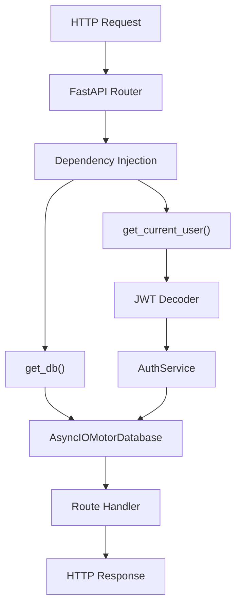

# Backend Core Engine

The Backend Core Engine serves as the foundational orchestration layer for the PrepUp ecosystem. It manages the application lifecycle, centralizes environment-driven configuration, abstracts asynchronous database connectivity via Motor, and implements a type-safe dependency injection (DI) system to ensure decoupled service architecture.

## System Role & Architectural Position

The Core Engine operates at the lowest level of the backend stack, providing essential cross-cutting concerns to the Identity and Access Management (IAM) and AI Processing pipelines. It ensures that every request is processed within a consistent environment, with validated configurations and authenticated principals.

### Core Configuration Schema

The system utilizes `pydantic-settings` to enforce strict type validation of environment variables at runtime.

| Parameter | Type | Default / Source | Description |
| :--- | :--- | :--- | :--- |
| `mongodb_url` | `str` | `mongodb://localhost:27017` | Connection string for the MongoDB cluster. |
| `jwt_secret` | `str` | Env Var | HMAC secret key for signing and verifying JWTs. |
| `groq_api_key` | `str` | Env Var | Authentication key for LLM and Whisper inference. |
| `audio_max_upload_bytes` | `int` | `8,000,000` | Hard limit on raw audio payload size to prevent DoS. |
| `audio_model` | `str` | `whisper-large-v3-turbo` | Specific transcription model identifier. |
| `frontend_url` | `str` | `http://localhost:5173` | CORS origin allow-list for the frontend client. |

## Core Execution & Data Flow Mechanics

The engine manages a strict initialization sequence during application startup to prevent runtime failures during request handling.

### Request Lifecycle Orchestration



### Execution Flow Key Points
*   **Singleton Database Handle**: The `_database` instance is cached globally after `connect_to_mongo()` is called during the FastAPI startup event, eliminating the overhead of recreating client pools per request.
*   **DI Chain**: The `get_current_user` dependency creates a chain: `Security Header` $\rightarrow$ `JWT Validation` $\rightarrow$ `Database Access` $\rightarrow$ `User Principal`.
*   **Lazy Initialization**: Database access is guarded by a `RuntimeError` if `get_database()` is invoked before the connection lifecycle is initialized.

## Implementation Deep Dive

### Environment Configuration
The `Settings` class leverages Pydantic's `BaseSettings` to provide a single source of truth for application constants.

```python title="backend/app/config.py"
class Settings(BaseSettings):
    app_name: str = "AI Interview Platform"
    app_version: str = "0.1.0"
    # ... other fields
    model_config = SettingsConfigDict(
        env_file=str(ENV_FILE_PATH),
        env_file_encoding="utf-8",
        case_sensitive=False,
        extra="ignore",
    )

settings = Settings()
```
**Mechanics:**
*   **`SettingsConfigDict`**: Configures the Pydantic engine to read from a `.env` file located relative to the module path.
*   **Type Coercion**: Automatically casts environment strings to `int` or `bool` based on type hints (e.g., `debug: bool`).
*   **Validation**: Fields like `audio_max_upload_bytes` use `Field(gt=0)` to ensure configuration invariants are maintained at boot.

### Asynchronous Database Connectivity
The engine uses `motor` for non-blocking MongoDB I/O, implementing a manual lifecycle management pattern.

```python title="backend/app/database.py"
_client: AsyncIOMotorClient | None = None
_database: AsyncIOMotorDatabase | None = None

async def connect_to_mongo() -> None:
    global _client, _database
    if _client is not None and _database is not None:
        return
    _client = AsyncIOMotorClient(settings.mongodb_url)
    _database = _client[settings.mongodb_db_name]

def get_database() -> AsyncIOMotorDatabase:
    if _database is None:
        raise RuntimeError("Database not initialized. Ensure app startup completed.")
    return _database
```
**Mechanics:**
*   **Global State**: `_client` and `_database` act as application-level singletons.
*   **Connection Pooling**: `AsyncIOMotorClient` handles connection pooling internally; the `connect_to_mongo` function ensures this pool is instantiated exactly once.
*   **Synchronous Accessor**: `get_database()` is a synchronous function returning the asynchronous handle, allowing it to be used easily within FastAPI dependencies.

### Authentication Dependency Injection
The `get_current_user` function is the primary gatekeeper for protected routes.

```python title="backend/app/dependencies.py"
async def get_current_user(
    credentials: HTTPAuthorizationCredentials | None = Depends(security),
    db: AsyncIOMotorDatabase = Depends(get_db),
) -> UserResponse:
    if credentials is None:
        raise UnauthorizedError("Missing Authorization header")

    payload = decode_access_token(credentials.credentials)
    if payload is None:
        raise UnauthorizedError("Invalid or expired access token")

    user_id = payload.get("sub")
    auth_service = AuthService(db)
    user = await auth_service.get_user_by_id(user_id)
    if user is None:
        raise UnauthorizedError("User not found")

    return user
```
**Mechanics:**
*   **`HTTPBearer`**: Intercepts the `Authorization: Bearer <token>` header.
*   **Token Decoding**: `decode_access_token` verifies the JWT signature using `settings.jwt_secret`.
*   **Principal Resolution**: The `sub` (subject) claim is used to query the database via `AuthService`, ensuring the user still exists in the system.

## Method Reference & Error Recovery

### Global Exception Hierarchy
The system implements a structured exception tree to map business logic failures to appropriate HTTP responses.

| Exception Class | Base Class | HTTP Status | Trigger Condition |
| :--- | :--- | :--- | :--- |
| `AppError` | `Exception` | 500 | Base class for all internal engine errors. |
| `UnauthorizedError` | `AppError` | 401 | Missing/invalid JWT or non-existent user. |
| `NotFoundError` | `AppError` | 404 | Requested resource ID does not exist in MongoDB. |
| `ConflictError` | `AppError` | 409 | Resource already exists (e.g., duplicate email). |

### Failure Modes & Recovery

| Failure Scenario | Detection Mechanism | Recovery / Result |
| :--- | :--- | :--- |
| **DB Connection Timeout** | `motor.motor_asyncio.AsyncIOMotorClient` timeout | App fails to start; logs connection error. |
| **Missing .env Variable** | Pydantic `ValidationError` | App crashes on boot with explicit missing field error. |
| **Expired JWT** | `decode_access_token` returns `None` | `UnauthorizedError` $\rightarrow$ HTTP 401. |
| **Uninitialized DB Access** | `get_database()` check | `RuntimeError` $\rightarrow$ HTTP 500 (Internal Server Error). |