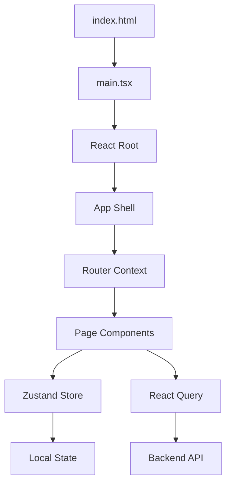

# Frontend Infrastructure

## Section A: System Role & Architectural Position

The Frontend Infrastructure serves as the foundational execution environment for the PrepUp client application. It is architected as a high-performance Single Page Application (SPA) utilizing **React 19** and **TypeScript**, bundled via **Vite 8**. This layer is responsible for the orchestration of client-side routing, global state synchronization, build-time optimization, and the enforcement of the design system's visual constraints.

The infrastructure utilizes a hybrid styling strategy: **Tailwind CSS 4.2** for utility-first rapid layout and **Custom CSS (CSS3)** for complex GPU-accelerated visual effects (e.g., multi-layered radial gradients and backdrop filters).

### Core Dependency Matrix

| Component | Technology | Version | Architectural Role |
| :--- | :--- | :--- | :--- |
| **Build Tool** | Vite | `^8.0.4` | ESM-based bundling, HMR, and asset optimization. |
| **Runtime** | React | `^19.2.4` | Component-based UI orchestration and DOM reconciliation. |
| **Type System** | TypeScript | `~6.0.2` | Static type safety and interface contract enforcement. |
| **Server State** | TanStack Query | `^5.99.0` | Asynchronous state caching and server synchronization. |
| **Client State** | Zustand | `^5.0.12` | Lightweight, atomic global state management. |
| **Styling** | Tailwind CSS | `^4.2.2` | Just-in-Time (JIT) utility CSS generation. |
| **Validation** | Zod | `^4.3.6` | Schema-based runtime type validation for API payloads. |

## Section B: Core Execution & Data Flow Mechanics

The frontend lifecycle initiates from a minimal HTML entry point, transitioning into a module-based execution flow where Vite handles the dependency graph. The application employs a "Shell-and-Page" architecture where the `app-shell` maintains persistent layout state while individual `page` containers manage domain-specific view logic.

### Bootstrapping & Render Pipeline



### Key Execution Invariants
*   **Hydration Sequence**: The `index.html` file serves as the static mount point (`#root`), delegating all subsequent rendering to the `main.tsx` module via `<script type="module">`.
*   **CSS Cascade**: Global styles in `App.css` define the high-level theme (colors, gradients), which are then extended by Tailwind utility classes for component-level spacing and responsiveness.
*   **Environment Isolation**: Build scripts separate `dev` (Vite HMR) from `build` (TypeScript check $\rightarrow$ Vite Bundle), ensuring that type errors prevent deployment.

## Section C: Implementation Deep Dive

### 1. Visual Identity & Global Styling
The application implements a sophisticated dark-mode aesthetic using multi-layered radial gradients to create depth and a "glassmorphism" effect for the navigation layer.

```css title="frontend/src/App.css"
.app-shell {
  min-height: 100dvh;
  background:
    radial-gradient(circle at 12% 0%, rgba(43, 98, 184, 0.28), rgba(43, 98, 184, 0) 36%),
    radial-gradient(circle at 88% 0%, rgba(13, 148, 136, 0.2), rgba(13, 148, 136, 0) 34%),
    linear-gradient(180deg, #060a12, #090f1b 42%, #070c16 100%);
  color: #d9e6fb;
}

.navbar {
  position: sticky;
  top: 0;
  z-index: 20;
  background: rgba(9, 15, 26, 0.82);
  backdrop-filter: blur(10px);
  border-bottom: 1px solid rgba(157, 180, 220, 0.22);
}
```
*   **`.app-shell`**: Uses `100dvh` (dynamic viewport height) to prevent layout shifts on mobile browsers. The background is a composite of two radial gradients for accent lighting and a linear gradient for the base depth.
*   **`.navbar`**: Implements `backdrop-filter: blur(10px)` combined with a semi-transparent background to achieve a frosted-glass effect, ensuring content readability during scroll.

### 2. Static Analysis & Linting Configuration
PrepUp utilizes the new **ESLint Flat Config** format to enforce strict TypeScript and React coding standards.

```javascript title="frontend/eslint.config.js"
export default defineConfig([
  globalIgnores(['dist']),
  {
    files: ['**/*.{ts,tsx}'],
    extends: [
      js.configs.recommended,
      tseslint.configs.recommended,
      reactHooks.configs.flat.recommended,
      reactRefresh.configs.vite,
    ],
    languageOptions: {
      ecmaVersion: 2020,
      globals: globals.browser,
    },
  },
])
```
*   **`globalIgnores(['dist'])`**: Prevents the linter from analyzing bundled production assets.
*   **`tseslint.configs.recommended`**: Enforces strict type checking and prevents the use of `any` where possible.
*   **`reactRefresh.configs.vite`**: Optimizes the linter for Vite's Fast Refresh capabilities, ensuring that state is preserved during hot module replacement.

### 3. Build Pipeline Orchestration
The `package.json` defines the operational lifecycle of the frontend, linking TypeScript compilation with the Vite build process.

```json title="frontend/package.json"
"scripts": {
  "dev": "vite",
  "build": "tsc -b && vite build",
  "lint": "eslint .",
  "preview": "vite preview"
}
```
*   **`dev`**: Launches the Vite development server with ESM imports.
*   **`build`**: Executes `tsc -b` (TypeScript build mode) to perform a full project type check before invoking `vite build` for Rollup-based bundling. This ensures no type-unsafe code reaches production.
*   **`lint`**: Runs the ESLint flat config against the entire source tree to ensure architectural consistency.

## Section D: State Reference & Error Recovery

### CSS Design Token Reference

| Selector | Property | Value | Technical Purpose |
| :--- | :--- | :--- | :--- |
| `.page` | `width` | `min(1480px, 96vw)` | Constrains content width while maintaining responsiveness. |
| `.btn-primary` | `background` | `linear-gradient(135deg, #2b75ff, #22b8ff)` | High-contrast call-to-action (CTA) branding. |
| `.field-input` | `background` | `rgba(8, 15, 27, 0.85)` | Maintains dark-theme consistency in forms. |
| `.page-dashboard`| `grid-template-columns` | `minmax(300px, 420px) minmax(0, 1fr)` | Implements a flexible sidebar-content layout. |

### Failure Modes & Recovery

| Failure Point | Indicator | Recovery Mechanism |
| :--- | :--- | :--- |
| **Build Failure** | `tsc -b` exit code $\neq 0$ | Immediate halt of CI/CD pipeline; developer must resolve type mismatches. |
| **Style Regression**| Visual artifacting in `.app-shell` | Verification of CSS cascade order; check if Tailwind utilities are overriding global `App.css` styles. |
| **Runtime Crash** | React Error Boundary Trigger | Catch-all boundary at the `App` level to prevent total application white-screen; triggers state reset. |
| **HMR Failure** | Page full-reload on save | Clear `.vite` cache directory and restart the `npm run dev` process. |