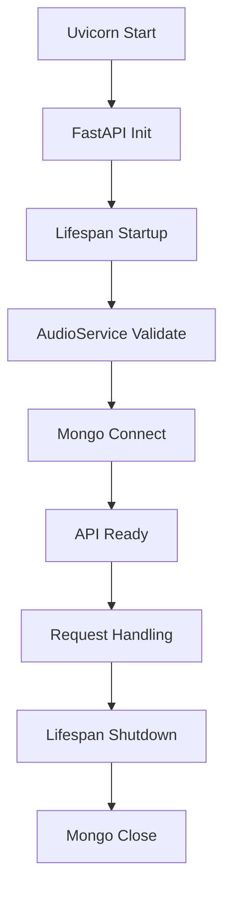

# System Foundation & Core

## System Role & Architectural Position

The System Foundation & Core layer serves as the orchestration substrate for the PrepUp platform. It manages the bootstrapping of the FastAPI backend runtime and the routing architecture of the React frontend. This layer is responsible for ensuring that infrastructure dependencies—specifically MongoDB connectivity and AI runtime configurations—are validated and initialized before the application accepts ingress traffic.

Architecturally, this layer sits beneath all domain-specific services (IAM, AI Pipeline, Analytics), providing the global exception handling, CORS policies, and dependency injection anchors required for stable execution.

### Core System Specifications

| Component | Technology | Responsibility | Critical Dependencies |
| :--- | :--- | :--- | :--- |
| **Backend Runtime** | FastAPI (Python 3.11+) | ASGI server, API routing, Lifespan mgmt | `uvicorn`, `pydantic-settings` |
| **Frontend Runtime** | React 18 / Vite / TS | Component tree, Client-side routing | `react-router-dom`, `tailwindcss` |
| **Data Persistence** | MongoDB Atlas | NoSQL document storage | `motor` (Async driver) |
| **LLM Orchestration** | Groq / Gemini | Inference and audio transcription | `GROQ_API_KEY`, `AUDIO_MODEL` |

## Core Execution & Data Flow Mechanics

The backend follows an asynchronous lifespan pattern. Upon startup, the system executes a sequence of validation and connection steps. If any critical dependency (e.g., MongoDB or FFMPEG paths) fails validation, the process terminates to prevent "zombie" states where the API is live but functionally impaired.

### Backend Initialization Sequence



### Execution Flow Key Points

*   **Runtime Validation**: The `AudioService.validate_runtime_configuration()` call ensures that the system environment has the required audio binaries (FFMPEG) and model configurations before the server binds to the port.
*   **Connection Pooling**: MongoDB connections are established during the `lifespan` startup and cached globally, ensuring that individual request handlers do not incur the overhead of TCP handshakes per call.
*   **Frontend Guarding**: The frontend employs a higher-order component (HOC) pattern via `ProtectedRoute`. This intercepts navigation attempts to sensitive routes (`/dashboard`, `/interview/:id`), validating the session token before rendering the target page.

## Implementation Deep Dive & Code Snippets

### Backend Orchestration & Lifespan

The backend entry point utilizes an `asynccontextmanager` to handle the application lifecycle, ensuring deterministic cleanup of database resources.

```python title="backend/app/main.py"
@asynccontextmanager
async def lifespan(_: FastAPI) -> AsyncIterator[None]:
    """Manage application startup and shutdown resources."""
    AudioService.validate_runtime_configuration()
    await connect_to_mongo()
    yield
    await close_mongo_connection()

app = FastAPI(
    title=settings.app_name,
    version=settings.app_version,
    debug=settings.debug,
    lifespan=lifespan,
)
```

**Mechanics:**
1.  **`AudioService.validate_runtime_configuration()`**: Synchronous check for environment-level dependencies.
2.  **`connect_to_mongo()`**: Asynchronous instantiation of the MongoDB client via the `motor` driver.
3.  **`yield`**: Marks the transition from the startup phase to the active request-handling phase.
4.  **`close_mongo_connection()`**: Gracefully closes the database pool during `SIGTERM` or `SIGINT` signals.

### Frontend Routing Architecture

The frontend uses a declarative routing structure where the `app-shell` provides a consistent layout (Navbar) across all views, and protected routes wrap authenticated domain logic.

```typescript title="frontend/src/App.tsx"
<Routes>
  <Route path="/" element={<LandingPage />} />
  <Route path="/login" element={<LoginPage />} />
  <Route path="/register" element={<RegisterPage />} />

  <Route element={<ProtectedRoute />}>
    <Route path="/dashboard" element={<DashboardPage />} />
    <Route path="/profile" element={<ProfilePage />} />
    <Route path="/configure" element={<ConfigurePage />} />
    <Route path="/interview/:sessionId" element={<InterviewRoomPage />} />
    <Route path="/analysis/:sessionId" element={<AnalysisPage />} />
  </Route>

  <Route path="*" element={<Navigate to="/" replace />} />
</Routes>
```

**Mechanics:**
1.  **`ProtectedRoute`**: A wrapper component that checks for the existence of a valid JWT/session. If absent, it triggers a redirect to `/login`.
2.  **Dynamic Routing**: The `:sessionId` parameter in the interview and analysis routes allows the `InterviewRoomPage` and `AnalysisPage` to fetch state based on the URI segment.
3.  **Catch-all Redirect**: The `*` route ensures that any undefined paths are normalized back to the landing page.

## Method / State Reference & Error Recovery

### Core Configuration Schema

The system relies on a strictly typed environment configuration. Missing variables trigger a `ValidationError` during the Pydantic settings instantiation.

| Environment Variable | Type | Default/Required | Purpose |
| :--- | :--- | :--- | :--- |
| `MONGODB_URL` | `string` | Required | Connection string for MongoDB Atlas cluster. |
| `JWT_SECRET` | `string` | Required | HMAC secret for signing authentication tokens. |
| `GROQ_API_KEY` | `string` | Required | API key for Llama-3.3 and Whisper models. |
| `FRONTEND_URL` | `string` | `http://localhost:5173` | CORS origin whitelist for the frontend client. |
| `AUDIO_FFMPEG_PATH` | `path` | System Dependent | Absolute path to the FFMPEG binary for audio processing. |

### Global Exception Recovery

The system implements a centralized error handling mechanism to ensure that internal server errors do not leak stack traces to the client, while maintaining structured error responses for known business logic failures.

```python title="backend/app/main.py"
@app.exception_handler(AppError)
async def app_error_handler(_: Request, exc: AppError) -> JSONResponse:
    """Serialize custom AppError exceptions into JSON API responses."""
    return JSONResponse(
        status_code=exc.status_code,
        content={"detail": str(exc), "type": type(exc).__name__},
    )
```

**Failure Mode Analysis:**
*   **`AppError` Trigger**: When a service throws a custom `AppError` (e.g., `AuthenticationError`, `SessionNotFoundError`), the `app_error_handler` intercepts it.
*   **Contract Consistency**: The response is always a `JSONResponse` with a `detail` and `type` key, allowing the frontend to implement specific UI feedback based on the `type` of error.
*   **Unhandled Exceptions**: Any exception not inheriting from `AppError` is handled by the default FastAPI handler, returning a `500 Internal Server Error` to prevent information disclosure.