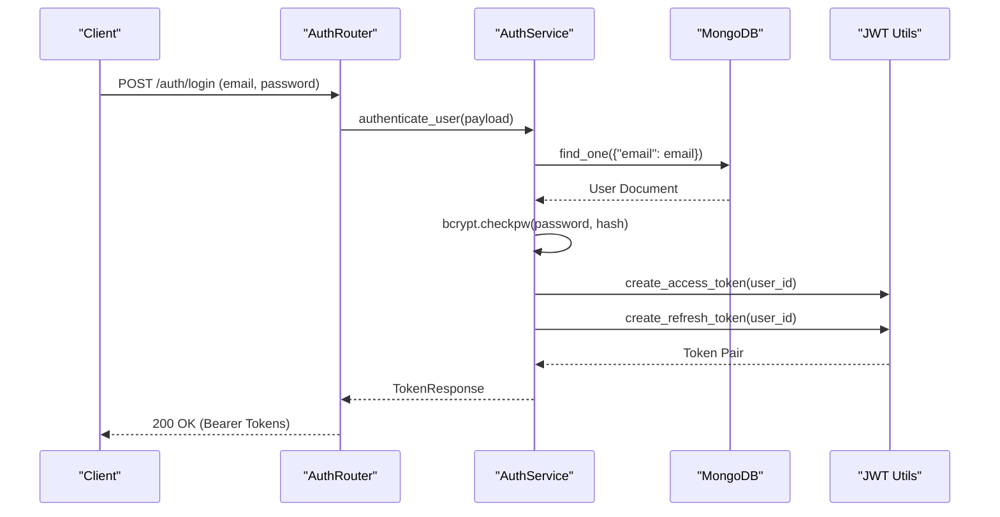

# IAM Backend Services

The IAM (Identity and Access Management) Backend Services provide the authoritative security layer for the PrepUp platform. This subsystem is responsible for identity persistence, credential verification via cryptographic hashing, and the issuance/validation of stateless session tokens using JSON Web Tokens (JWT). It operates as a critical gatekeeper, ensuring that only authenticated principals can access protected domain resources.

### System Role & Architectural Position

The IAM backend sits between the API Gateway (FastAPI) and the Persistence Layer (MongoDB). It leverages a decoupled service architecture where the `AuthRouter` handles HTTP concerns, the `AuthService` encapsulates business logic, and the `jwt` utility module manages the cryptographic signing and decoding of tokens.

| Component | Responsibility | Technical Specification |
| :--- | :--- | :--- |
| `AuthRouter` | Request routing & Schema validation | FastAPI `APIRouter`, Pydantic models |
| `AuthService` | Domain logic & User lifecycle | Python 3.10+, `motor` (Async MongoDB) |
| `jwt.py` | Token minting & Signature verification | `python-jose`, HS256 Algorithm |
| `bcrypt` | One-way password hashing | Adaptive hashing with salted rounds |
| `MongoDB` | Identity storage | BSON document store, Unique Index on `email` |

### Core Execution & Data Flow Mechanics

The system implements a dual-token rotation strategy to balance security and user experience. Short-lived **Access Tokens** are used for request authorization, while long-lived **Refresh Tokens** allow the client to obtain new access tokens without re-authenticating.



**Key Execution Invariants:**
*   **Normalization:** All email addresses are lower-cased before storage or lookup to prevent duplicate accounts with varying casing.
*   **Password Security:** Plain-text passwords never persist; they are hashed using `bcrypt` with a randomly generated salt.
*   **Statelessness:** The server does not store session IDs in memory; all identity state is encapsulated within the JWT `sub` (subject) claim.
*   **Token Isolation:** Access tokens and Refresh tokens are distinguished by a `type` claim, preventing a refresh token from being used as an access token for API endpoints.

### Implementation Deep Dive

#### 1. Identity Persistence & Registration
The `AuthService` manages the transition from a `UserCreate` DTO to a persisted MongoDB document.

```python title="backend/app/services/auth_service.py"
async def register_user(self, payload: UserCreate) -> UserResponse:
    existing_user = await self.collection.find_one({"email": payload.email.lower()})
    if existing_user is not None:
        raise ConflictError("A user with this email already exists")

    now = datetime.now(timezone.utc)
    password_hash = self._hash_password(payload.password)

    user_doc = {
        "email": payload.email.lower(),
        "full_name": payload.full_name,
        "password_hash": password_hash,
        "created_at": now,
        "updated_at": now,
    }

    result = await self.collection.insert_one(user_doc)
    user_doc["_id"] = result.inserted_id

    return self._to_user_response(user_doc)
```
*   **Line-by-line Mechanics:**
    *   **Conflict Check:** Performs an asynchronous lookup on the `email` field to ensure uniqueness.
    *   **Hashing:** Invokes `_hash_password`, which utilizes `bcrypt.hashpw` to compute a computationally expensive hash.
    *   **Atomic Insertion:** Uses `insert_one` to commit the user document to the `users` collection.
    *   **Transformation:** The `_to_user_response` method strips the `password_hash` before returning the data to the router.

#### 2. Cryptographic Token Minting
The JWT utility implements a generalized token creator that enforces expiration and type-safety.

```python title="backend/app/utils/jwt.py"
def _create_token(subject: str, token_type: str, expires_delta: timedelta) -> str:
    now = datetime.now(timezone.utc)
    expire_at = now + expires_delta

    payload: dict[str, Any] = {
        "sub": subject,
        "type": token_type,
        "iat": int(now.timestamp()),
        "exp": int(expire_at.timestamp()),
    }

    return jwt.encode(payload, settings.jwt_secret, algorithm=settings.jwt_algorithm)
```
*   **Claim Analysis:**
    *   `sub`: The unique MongoDB `ObjectId` of the user.
    *   `type`: String identifier (`access` or `refresh`) to prevent token misuse.
    *   `iat` (Issued At): Epoch timestamp of token creation.
    *   `exp` (Expiration): Epoch timestamp after which the token is considered invalid by the `jose` library.

#### 3. Authentication Route Handling
The router leverages FastAPI's dependency injection to provide database access and user context.

```python title="backend/app/routers/auth.py"
@router.post("/refresh", response_model=TokenResponse)
async def refresh_token(
    payload: RefreshTokenRequest,
    db: AsyncIOMotorDatabase = Depends(get_db),
) -> TokenResponse:
    auth_service = AuthService(db)
    return await auth_service.refresh_tokens(payload.refresh_token)
```
*   **Dependency Flow:** The `get_db` dependency injects the `AsyncIOMotorDatabase` instance, which is then passed to the `AuthService` constructor, ensuring a clean separation between the transport layer and the business logic.

### Method / State Reference & Error Recovery

#### JWT Payload Schema
The following table defines the structure of the signed claims used across the system.

| Claim | Type | Description | Validation Logic |
| :--- | :--- | :--- | :--- |
| `sub` | `string` | User ID (MongoDB ObjectId) | Must exist in the `users` collection |
| `type` | `string` | Token Purpose | Must match `access` for API or `refresh` for `/refresh` |
| `iat` | `integer` | Issued At | Used for auditing and token age tracking |
| `exp` | `integer` | Expiration Time | Must be $\ge$ `current_time` |

#### Error Recovery & Failure Modes

| Exception | HTTP Status | Trigger Condition | Recovery Action |
| :--- | :--- | :--- | :--- |
| `ConflictError` | `409 Conflict` | Email already exists in DB | Prompt user to login or use a different email |
| `UnauthorizedError` | `401 Unauthorized` | Invalid password or expired token | Force re-authentication via `/auth/login` |
| `JWTError` | `401 Unauthorized` | Malformed token or signature mismatch | Invalidate client-side token and redirect to login |
| `ObjectId` Invalid | `401 Unauthorized` | Token `sub` is not a valid BSON ObjectId | Treat as invalid token; trigger logout |