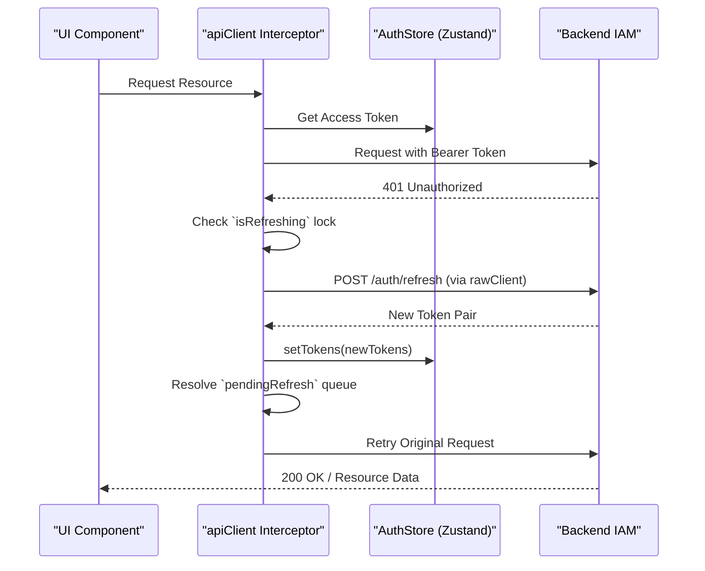

# Client Auth Proxy

## System Role & Architectural Position

The Client Auth Proxy serves as the centralized orchestration layer for authentication state and identity propagation within the PrepUp frontend. It abstracts the complexities of JWT (JSON Web Token) lifecycle management—specifically token injection, expiration handling, and silent refreshment—from the domain-specific UI components.

Positioned between the React component tree and the Backend IAM services, this layer ensures that every outgoing request is cryptographically signed and that the application state remains synchronized with the server-side session validity.

### Technical Specifications & Dependencies

| Component | Technology | Responsibility | Key Dependency |
| :--- | :--- | :--- | :--- |
| `apiClient` | Axios | Request/Response interception & HTTP transport | `useAuthStore` (Zustand) |
| `authApi` | TypeScript | Type-safe API service definitions | `apiClient` |
| `ProtectedRoute` | React Router | Route-level authorization guard | `useIsAuthenticated` hook |
| `rawClient` | Axios | Unintercepted transport for auth-critical calls | N/A |

## Core Execution & Data Flow Mechanics

The proxy implements a sophisticated request-response interceptor chain to handle the "thundering herd" problem during token expiration. When multiple concurrent requests fail with a `401 Unauthorized` status, the proxy locks the refresh process to ensure only one token refresh call is dispatched to the backend.

### Token Refresh Sequence



### Interceptor Logic Flow
1.  **Request Phase**: The `attachAccessToken` function queries the Zustand store. If `accessToken` is present, it injects the `Authorization: Bearer <token>` header.
2.  **Response Phase (Success)**: Pass-through for all non-error responses.
3.  **Response Phase (Failure)**: 
    *   Intercepts `401` errors.
    *   Filters out `/auth/refresh` calls to prevent infinite recursion.
    *   Checks the `_retry` flag on the request config to prevent infinite retry loops.
    *   Implements a mutex-like lock using `isRefreshing` and a `pendingRefresh` promise to queue concurrent requests.
    *   On successful refresh, updates the global state and re-executes the original request with the new token.

## Implementation Deep Dive

### Request Interception & Concurrency Control

The core of the proxy resides in the Axios interceptor configuration, which manages the transition from an expired session to a renewed one.

```typescript title="frontend/src/api/client.ts"
let isRefreshing = false
let pendingRefresh: Promise<string | null> | null = null

apiClient.interceptors.response.use(
	(response) => response,
	async (error: AxiosError) => {
		const originalRequest = error.config
		const isUnauthorized = error.response?.status === 401
		const isRefreshRequest = originalRequest?.url?.includes('/auth/refresh')

		if (!originalRequest || !isUnauthorized || isRefreshRequest) {
			return Promise.reject(error)
		}

		const retryFlag = (originalRequest as InternalAxiosRequestConfig & { _retry?: boolean })._retry
		if (retryFlag) return Promise.reject(error)

		;(originalRequest as InternalAxiosRequestConfig & { _retry?: boolean })._retry = true

		if (!isRefreshing) {
			isRefreshing = true
			pendingRefresh = refreshAccessToken().finally(() => {
				isRefreshing = false
			})
		}

		const nextAccessToken = await pendingRefresh
		if (!nextAccessToken) return Promise.reject(error)

		originalRequest.headers.Authorization = `Bearer ${nextAccessToken}`
		return apiClient.request(originalRequest)
	},
)
```

**Mechanics Analysis:**
- **`isRefreshing`**: A boolean semaphore preventing multiple simultaneous calls to the `/auth/refresh` endpoint.
- **`pendingRefresh`**: A promise reference that allows subsequent `401` requests to "await" the result of the first refresh attempt.
- **`_retry` flag**: Injected into the `InternalAxiosRequestConfig` to ensure a request is only retried once, preventing deadlocks if the refresh token itself is expired.
- **`rawClient`**: Used within `refreshAccessToken` to bypass the `apiClient` interceptors, avoiding circular dependencies.

### API Abstraction Layer

The `authApi` object provides a strongly-typed interface for authentication actions, decoupling the UI from the specific URI structure of the backend.

```typescript title="frontend/src/api/auth.ts"
export const authApi = {
	register: async (payload: RegisterRequest): Promise<UserProfile> => {
		const { data } = await apiClient.post<UserProfile>('/auth/register', payload)
		return data
	},
	login: async (payload: LoginRequest): Promise<TokenResponse> => {
		const { data } = await apiClient.post<TokenResponse>('/auth/login', payload)
		return data
	},
	refresh: async (payload: RefreshTokenRequest): Promise<TokenResponse> => {
		const { data } = await apiClient.post<TokenResponse>('/auth/refresh', payload)
		return data
	},
	me: async (): Promise<UserProfile> => {
		const { data } = await apiClient.get<UserProfile>('/auth/me')
		return data
	},
} as const
```

**Contract Specifications:**
- **`register`**: Dispatches `RegisterRequest` $\rightarrow$ returns `UserProfile`.
- **`login`**: Dispatches `LoginRequest` $\rightarrow$ returns `TokenResponse` (contains `access_token` and `refresh_token`).
- **`me`**: Performs a GET request to validate the current session and retrieve the authenticated user's profile.

### Route Guarding

The `ProtectedRoute` component acts as a higher-order component (HOC) wrapper for restricted views.

```typescript title="frontend/src/components/layout/ProtectedRoute.tsx"
export function ProtectedRoute() {
	const isAuthenticated = useIsAuthenticated()

	if (!isAuthenticated) {
		return <Navigate to="/login" replace />
	}

	return <Outlet />
}
```

**Execution Logic:**
- **`useIsAuthenticated()`**: A selector from `authStore` that computes boolean auth state based on token presence.
- **`<Navigate replace />`**: Redirects unauthenticated users to the login page and replaces the current entry in the history stack to prevent "back-button" loops.
- **`<Outlet />`**: The React Router placeholder that renders child routes if the authentication invariant is met.

## Method / State Reference & Error Recovery

### API Contract Reference

| Method | Endpoint | Input Type | Output Type | Auth Required |
| :--- | :--- | :--- | :--- | :--- |
| `POST` | `/auth/register` | `RegisterRequest` | `UserProfile` | No |
| `POST` | `/auth/login` | `LoginRequest` | `TokenResponse` | No |
| `POST` | `/auth/refresh` | `RefreshTokenRequest`| `TokenResponse` | No (Refresh Token) |
| `GET` | `/auth/me` | N/A | `UserProfile` | Yes (Access Token) |

### Error Recovery & Failure Modes

| Scenario | Detection | Recovery Action | Result |
| :--- | :--- | :--- | :--- |
| **Expired Access Token** | `401 Unauthorized` | Trigger `refreshAccessToken()` | Transparent retry of request |
| **Expired Refresh Token** | `401` on `/auth/refresh` | Invoke `logout()` in `authStore` | Redirect to `/login` |
| **Missing Refresh Token** | `!refreshToken` check | Immediate `logout()` | Session termination |
| **Network Timeout** | `AxiosError` (timeout) | Standard error propagation | UI Error Boundary/Toast |
| **Invalid Payload** | `422 Unprocessable Entity` | Propagate to UI via `catch` block | Validation error display |