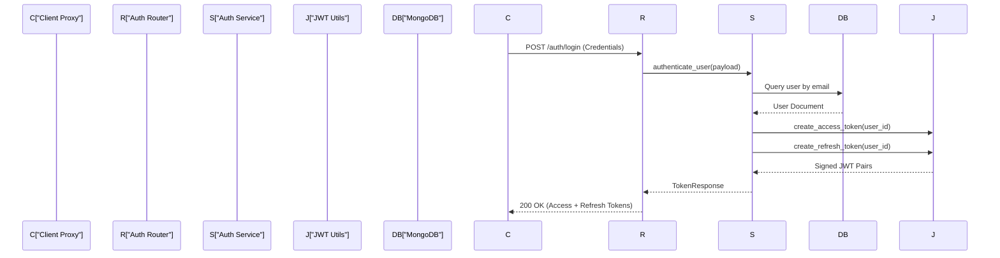

# Identity & Access Management

## System Role & Architectural Position

The Identity & Access Management (IAM) module serves as the centralized security layer for the PrepUp ecosystem. It implements a stateless authentication mechanism using JSON Web Tokens (JWT) to govern identity propagation across the distributed system. The architecture is designed to decouple credential validation from session authorization, employing a dual-token strategy (Short-lived Access Tokens and Long-lived Refresh Tokens) to balance security with user experience.

The IAM layer sits between the **Client Auth Proxy** and the **Domain Persistence** layer, ensuring that no business logic in the AI Processing Pipeline or Analytics Engine is executed without a verified `sub` (subject) claim.

### Architecture Specifications

| Component | Technology | Responsibility | Key Configuration / Invariants |
| :--- | :--- | :--- | :--- |
| **Token Engine** | `python-jose` | JWT signing, encoding, and decoding | `settings.jwt_secret`, `HS256` algorithm |
| **API Gateway** | `FastAPI` | Route handling and dependency injection | `get_current_user` security dependency |
| **Persistence** | `Motor` (MongoDB) | User credential and profile storage | Indexed `email` field for $O(1)$ lookup |
| **Client Proxy** | `Axios` / `TS` | API abstraction and token lifecycle | `TokenResponse` type enforcement |

## Core Execution & Data Flow Mechanics

The IAM system operates on a request-response cycle where the client must provide a valid Bearer token in the `Authorization` header for protected resources. The lifecycle revolves around the rotation of access tokens via refresh tokens to minimize the impact of a potential token leak.

### Authentication Sequence Flow



### Key Operational Invariants

*   **Token Differentiation**: Access tokens and refresh tokens are distinguished by a `type` claim within the payload. The `decode_access_token` and `decode_refresh_token` utilities strictly enforce this check to prevent "token substitution attacks" (e.g., using a refresh token to access a protected API).
*   **Stateless Verification**: The backend does not store active access tokens in memory; verification is performed via cryptographic signature validation using the `jwt_secret`.
*   **Identity Propagation**: The `get_current_user` dependency extracts the `sub` claim from the JWT, queries the database, and injects the `UserResponse` object into the request handler, ensuring type-safe access to the authenticated user's profile.

## Implementation Deep Dive & Code Snippets

### JWT Lifecycle Management

The system utilizes a private helper `_create_token` to standardize the payload structure across different token types.

```python title="backend/app/utils/jwt.py"
def _create_token(subject: str, token_type: str, expires_delta: timedelta) -> str:
    now = datetime.now(timezone.utc)
    expire_at = now + expires_delta

    payload: dict[str, Any] = {
        "sub": subject,
        "type": token_type,
        "iat": int(now.timestamp()),
        "exp": int(expire_at.timestamp()),
    }

    return jwt.encode(payload, settings.jwt_secret, algorithm=settings.jwt_algorithm)
```
- **Line 2-3**: Establishes UTC-aware timestamps to prevent drift across server environments.
- **Line 6-11**: Constructs the JWT claims. `sub` maps to the MongoDB `_id`, while `iat` (issued at) and `exp` (expiration) govern the token's temporal validity.
- **Line 13**: Encodes the payload using the HMAC-SHA256 algorithm defined in global settings.

### Server-Side Route Handling

The `auth.py` router exposes the external interface for the IAM system, delegating business logic to the `AuthService`.

```python title="backend/app/routers/auth.py"
@router.get("/me", response_model=UserResponse)
async def get_me(current_user: UserResponse = Depends(get_current_user)) -> UserResponse:
    """Return the authenticated user's profile from the access token."""
    return current_user
```
- **`Depends(get_current_user)`**: This is a FastAPI dependency injection. It intercepts the request, extracts the Bearer token from the `Authorization` header, validates it via `decode_access_token`, and retrieves the user from the DB.
- **Complexity**: This reduces the boilerplate in protected routes, ensuring that by the time the function body executes, the user is guaranteed to be authenticated.

### Client-Side API Abstraction

The frontend implements a clean proxy to handle asynchronous authentication requests with strict TypeScript typing.

```typescript title="frontend/src/api/auth.ts"
export const authApi = {
    login: async (payload: LoginRequest): Promise<TokenResponse> => {
        const { data } = await apiClient.post<TokenResponse>('/auth/login', payload)
        return data
    },
    refresh: async (payload: RefreshTokenRequest): Promise<TokenResponse> => {
        const { data } = await apiClient.post<TokenResponse>('/auth/refresh', payload)
        return data
    },
} as const
```
- **`as const`**: Ensures the `authApi` object is treated as a read-only literal, preventing runtime mutations.
- **Generic `apiClient`**: The use of `<TokenResponse>` ensures that the returned data is typed, allowing the frontend state manager to safely access `accessToken` and `refreshToken`.

## Method / State Reference & Error Recovery

### API Contract Reference

| Endpoint | Method | Request Body | Response | Success Code |
| :--- | :--- | :--- | :--- | :--- |
| `/auth/register` | `POST` | `UserCreate` | `UserResponse` | `201 Created` |
| `/auth/login` | `POST` | `UserLogin` | `TokenResponse` | `200 OK` |
| `/auth/refresh` | `POST` | `RefreshTokenRequest` | `TokenResponse` | `200 OK` |
| `/auth/me` | `GET` | N/A | `UserResponse` | `200 OK` |

### Failure Modes & Recovery

| Failure Mode | Detection Mechanism | System Response | Recovery Path |
| :--- | :--- | :--- | :--- |
| **Expired Access Token** | `jwt.decode` throws `ExpiredSignatureError` | `401 Unauthorized` | Client triggers `/auth/refresh` using the stored Refresh Token. |
| **Invalid Token Type** | `payload.get("type") != "access"` | `401 Unauthorized` | Re-authentication required via `/auth/login`. |
| **Invalid Signature** | `JWTError` during decode | `401 Unauthorized` | Immediate session termination; clear local storage. |
| **Refresh Token Expired** | `decode_refresh_token` returns `None` | `401 Unauthorized` | Hard redirect to `/login` page. |