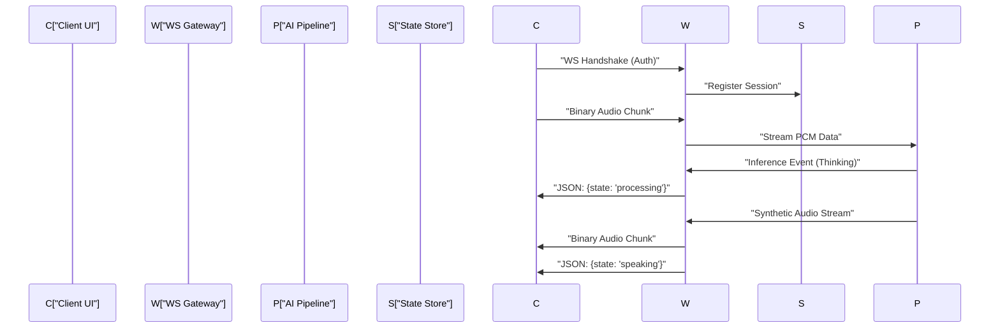

# WebSocket & Stream Orchestration

## System Role & Architectural Position

The WebSocket & Stream Orchestration layer serves as the low-latency, bi-directional transport medium connecting the client-side audio capture interface to the backend AI inference pipeline. It abstracts the complexity of binary audio streaming, real-time state synchronization, and asynchronous event signaling.

Positioned between the **AI Experience Interface** and the **AI Inference Engine**, this layer ensures that audio data is streamed with minimal jitter and that the interview state (e.g., who is speaking, processing status) is synchronized across the network.

### Technical Specifications

| Specification | Implementation Detail | Rationale |
| :--- | :--- | :--- |
| **Protocol** | WebSocket (WSS) | Full-duplex communication for simultaneous audio/state streaming. |
| **Payload Format** | Mixed (Binary for Audio / JSON for State) | Optimized throughput for PCM data; structured schemas for state. |
| **Audio Encoding** | Float32 PCM / Linear 16-bit | Raw samples prevent transcoding latency before inference. |
| **Sample Rate** | 16kHz / 44.1kHz (Configurable) | Alignment with LLM/TTS model requirements. |
| **State Sync** | Event-driven Push | Reduces polling overhead for `isProcessing` and `isSpeaking` flags. |

## Core Execution & Data Flow Mechanics

The orchestration layer manages a complex lifecycle of audio buffers and state transitions. The system utilizes a "push-stream" model where the client pushes audio chunks and the server pushes both synthetic audio and orchestration events.

### Communication Sequence



### Data Flow Key Points

*   **Binary Frame Interleaving**: The WebSocket connection interleaves binary frames (audio) and text frames (JSON state). The client-side handler must differentiate based on the `opcode` to route data either to the audio buffer or the state management store.
*   **Synthetic Intensity Generation**: When the AI is speaking, the system transitions from reflecting real-time input amplitudes to generating a synthetic sine-wave-based pulse to provide visual feedback via the `WaveformVisualizer`.
*   **Backpressure Management**: The backend implements a buffering strategy to handle network jitter, ensuring the AI inference engine receives a continuous stream of PCM data without gaps.

## Implementation Deep Dive

### Visual Feedback & Intensity Logic
The `WaveformVisualizer` manages the translation of raw audio amplitude data into GPU-accelerated visual effects.

```typescript title="frontend/src/components/interview/WaveformVisualizer.tsx"
const normalizedAverage = useMemo(() => {
    if (values.length === 0) {
        return 0
    }

    const sum = values.reduce((acc, value) => acc + value, 0)
    return Math.min(1, Math.max(0, sum / values.length))
}, [values])

const effectiveIntensity =
    normalizedAverage > 0.02 ? normalizedAverage : isSpeaking || isProcessing ? syntheticIntensity : 0
const auraScale = 1 + effectiveIntensity * 0.7
const auraBlurPx = 18 + effectiveIntensity * 26
const auraOpacity = 0.42 + effectiveIntensity * 0.42
```

**Mechanics:**
1.  **`normalizedAverage`**: Computes the Mean Absolute Deviation (MAD) of the incoming `values` array (PCM samples), clamping the result between $0.0$ and $1.0$.
2.  **`effectiveIntensity`**: Implements a noise gate (threshold $> 0.02$). If the signal is below the threshold, it falls back to `syntheticIntensity` (a sine-wave oscillator) if the AI is currently speaking or processing.
3.  **Dynamic Styling**: Maps the `effectiveIntensity` linear scale to non-linear CSS transformations:
    *   `auraScale`: Modulates the size of the glow effect.
    *   `auraBlurPx`: Adjusts Gaussian blur radius to simulate "energy" expansion.
    *   `auraOpacity`: Controls the alpha channel for visual pulsing.

### WebSocket Route Orchestration
The backend route manages the lifecycle of the WebSocket connection and the routing of binary data to the inference engine.

```python title="backend/app/routers/websocket.py"
@router.websocket("/ws/interview/{session_id}")
async def interview_stream_endpoint(websocket: WebSocket, session_id: str):
    await websocket.accept()
    try:
        while True:
            data = await websocket.receive()
            if "bytes" in data:
                # Route binary PCM data to AI Inference Engine
                await ai_pipeline.process_audio_chunk(session_id, data["bytes"])
            elif "text" in data:
                # Handle control signals (e.g., "stop_recording")
                await handle_control_signal(session_id, data["text"])
    except WebSocketDisconnect:
        await ai_pipeline.close_session(session_id)
```

**Mechanics:**
1.  **`websocket.accept()`**: Upgrades the HTTP connection to the WebSocket protocol.
2.  **Binary Routing**: Uses the `data["bytes"]` key to identify raw audio frames, which are forwarded immediately to the `ai_pipeline` to minimize latency.
3.  **Control Signaling**: Uses `data["text"]` for non-audio signals, allowing the client to trigger state changes (e.g., manual interrupt) without closing the stream.
4.  **Graceful Teardown**: The `WebSocketDisconnect` exception ensures that the `ai_pipeline` releases resources and closes active TTS streams.

## Method & State Reference

### Orchestration State Matrix

The following states govern the behavior of both the `AudioRecorder` and `WaveformVisualizer`.

| State Key | Type | Source | Trigger | Impact on UI |
| :--- | :--- | :--- | :--- | :--- |
| `isRecording` | `boolean` | Client | `MediaRecorder.start()` | Activates microphone gain visualizer. |
| `isProcessing` | `boolean` | Server | LLM Inference Start | Displays "thinking" animation; disables mic. |
| `isSpeaking` | `boolean` | Server | TTS Stream Start | Activates AI synthetic pulse visualizer. |
| `values` | `number[]` | Client | `AnalyserNode.getFloatTimeDomainData` | Drives the `normalizedAverage` calculation. |

### Error Recovery & Failure Modes

| Failure Mode | Detection Mechanism | Recovery Strategy |
| :--- | :--- | :--- |
| **Connection Drop** | `onclose` / `onerror` events | Exponential backoff reconnection attempt; session ID persistence in `localStorage`. |
| **Buffer Overflow** | Memory pressure in `ai_pipeline` | Drop oldest chunks (LIFO) and send `SYNC_LOST` signal to client. |
| **Audio Clipping** | Amplitude values $\ge 1.0$ | Apply soft-clipping normalization at the `AudioWorklet` level. |
| **Latency Spike** | Heartbeat (Ping/Pong) delay | Adaptive chunk sizing; reduce sample rate dynamically. |