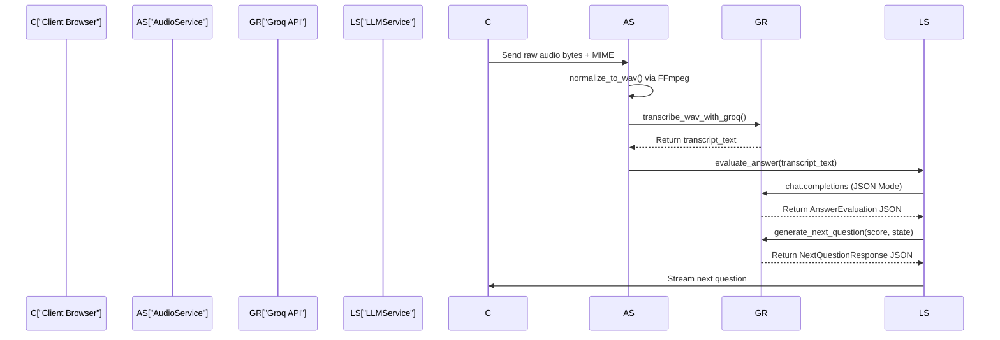

# AI Inference Engine

The AI Inference Engine serves as the cognitive core of the PrepUp platform, orchestrating the transformation of raw browser-captured audio into structured interview evaluations and dynamic conversational trajectories. It implements a decoupled architecture separating signal processing (transcription) from cognitive reasoning (LLM generation), utilizing Groq's LPU (Language Processing Unit) acceleration for near-real-time latency.

## System Role & Architectural Position

The Inference Engine operates as the primary downstream consumer of the WebSocket stream orchestration layer. It is responsible for three critical domains: audio signal normalization, speech-to-text (STT) conversion, and state-aware prompt execution.

### Technical Specifications & Dependencies

| Component | Technology/Provider | Responsibility | Critical Configuration |
| :--- | :--- | :--- | :--- |
| **Transcription** | Groq Whisper | Audio $\rightarrow$ Text conversion | `AUDIO_MODEL` (e.g., whisper-large-v3) |
| **Cognitive Engine** | Groq Llama 3.3 70B | Reasoning, Evaluation, Generation | `model="llama-3.3-70b-versatile"` |
| **Signal Processing** | FFmpeg | Audio transcoding & normalization | `AUDIO_FFMPEG_PATH` |
| **Schema Validation** | Pydantic | Response structure enforcement | `response_format={"type": "json_object"}` |

## Core Execution & Data Flow Mechanics

The engine implements a synchronous-to-asynchronous bridge. While the Groq SDK calls are blocking, they are wrapped in `asyncio.to_thread` to prevent event-loop starvation during high-concurrency interview sessions.

### Inference Pipeline Sequence



### Key Execution Invariants
- **Signal Normalization**: All incoming audio, regardless of browser format (WebM, OGG, MP4), is normalized to **16 kHz mono WAV** to ensure optimal Whisper transcription accuracy.
- **Dynamic Difficulty**: The `LLMService` calculates a `difficulty_hint` (easier, moderate, harder) based on the `current_score` (0.0-1.0), adjusting the prompt context for the subsequent question.
- **JSON Enforcement**: All LLM interactions utilize Groq's `json_object` mode with strict Pydantic model validation to prevent parsing failures during state transitions.

## Implementation Deep Dive

### Audio Normalization Orchestration

The `AudioService` manages the lifecycle of temporary files and subprocess execution to interface with FFmpeg.

```python title="backend/app/services/audio_service.py"
def normalize_to_wav(self, audio_bytes: bytes, mime_type: str) -> NormalizedAudioResult:
    # ... [setup temp directory] ...
    command = [
        ffmpeg_executable,
        "-y",
        "-i", str(input_path),
        "-ac", "1",       # Force mono
        "-ar", "16000",   # Force 16kHz
        "-f", "wav",      # Force WAV container
        str(output_path),
    ]

    try:
        process = subprocess.run(
            command,
            check=False,
            capture_output=True,
            text=True,
            timeout=settings.audio_conversion_timeout_seconds,
        )
    except subprocess.TimeoutExpired as exc:
        raise AudioProcessingError("AUDIO_CONVERSION_TIMEOUT", ...)
    # ... [read bytes and calculate latency] ...
```

**Mechanics:**
1. **Container Inference**: `_build_input_name` maps MIME types to extensions (e.g., `audio/webm` $\rightarrow$ `.webm`) to help FFmpeg correctly identify the input codec.
2. **Strict Sampling**: `-ar 16000` and `-ac 1` ensure the audio matches the expected input tensor shape for the Whisper model.
3. **Latency Tracking**: Uses `time.perf_counter()` to measure `conversion_latency_ms`, enabling system-wide performance monitoring.

### Structured LLM Interaction

The `LLMService` implements a robust JSON extraction pattern to handle potential model hallucinations or wrapping text.

```python title="backend/app/services/llm_service.py"
async def _call_groq_json(self, prompt: str, response_model: type) -> Any:
    response = self.client.chat.completions.create(
        model=self.model,
        messages=[{"role": "user", "content": prompt}],
        temperature=0.2, # Low temperature for deterministic structured output
        max_tokens=2048,
        response_format={"type": "json_object"},
    )

    response_text = response.choices[0].message.content.strip()

    try:
        data = json.loads(response_text)
    except json.JSONDecodeError:
        # Fallback: Regex extraction of JSON block
        json_match = re.search(r"\{.*\}", response_text, re.DOTALL)
        if json_match:
            data = json.loads(json_match.group())
        else:
            raise ValueError(f"No valid JSON found in response: {response_text}")
    
    return response_model(**data)
```

**Mechanics:**
1. **Determinism**: `temperature=0.2` is used to minimize variance in structured evaluations.
2. **Regex Recovery**: The `re.search` fallback ensures that if the model includes conversational filler outside the JSON block, the system can still recover the structured data.
3. **Type Casting**: The `response_model(**data)` call leverages Pydantic to enforce type safety before the data reaches the domain layer.

## Method Reference & Error Recovery

### LLM API Contract

| Method | Key Inputs | Return Type | Primary Purpose |
| :--- | :--- | :--- | :--- |
| `generate_opening_questions` | `domain`, `role`, `difficulty` | `list[str]` | Initializes the interview with 3 targeted questions. |
| `generate_next_question` | `current_score`, `summary` | `str` | Adaptive question generation based on performance. |
| `evaluate_answer` | `question`, `answer` | `AnswerEvaluation` | Scores responses and identifies missing keywords. |
| `generate_final_analysis` | `qa_pairs`, `all_scores` | `FinalAnalysis` | Aggregates session data into a hiring recommendation. |

### Failure Modes & Recovery

The engine implements a structured `AudioProcessingError` to differentiate between transient and terminal failures.

| Error Code | Cause | Recovery Strategy | Retryable |
| :--- | :--- | :--- | :--- |
| `INVALID_AUDIO_TYPE` | Unsupported MIME type | Client-side encoder update | No |
| `AUDIO_CONVERSION_TIMEOUT` | FFmpeg process hang | Terminate subprocess, retry once | Yes |
| `TRANSCRIPTION_TIMEOUT` | Groq API latency | Exponential backoff | Yes |
| `TRANSCRIPTION_PROVIDER_FAILURE` | API Error/Empty Response | Fail-over to alternative model | Yes |

### Final Analysis Schema

The output of `generate_final_analysis` is mapped to the following structure for consumption by the Analytics Visualization Layer:

```json title="FinalAnalysis Schema"
{
  "overall_score": 0.82,
  "category_scores": {
    "technical_accuracy": 0.9,
    "communication": 0.7,
    "problem_solving": 0.8,
    "depth_of_knowledge": 0.85,
    "confidence": 0.75
  },
  "top_strengths": ["System Design", "Concurrency"],
  "improvement_areas": ["Articulation of trade-offs"],
  "detailed_feedback": "...",
  "recommended_resources": ["..."],
  "hire_recommendation": "strong_hire" // [strong_hire, hire, maybe, no_hire]
}