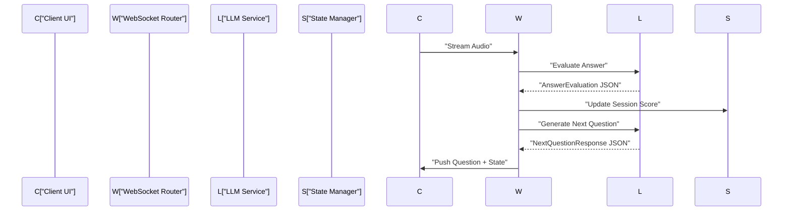

# AI Processing Pipeline

The AI Processing Pipeline is the mission-critical orchestration layer of PrepUp, responsible for transforming raw audio input into a structured, adaptive interview experience. It integrates real-time streaming via WebSockets with an inference engine powered by Groq to maintain a low-latency feedback loop between the candidate's responses and the AI interviewer's questions.

## System Role & Architectural Position

The pipeline operates as a stateful bridge between the frontend `AudioRecorder` and the LLM inference backend. It manages the transition of data through three primary phases: Capture (Audio $\rightarrow$ Text), Inference (Text $\rightarrow$ Evaluation $\rightarrow$ Next Question), and Synthesis (Text $\rightarrow$ Voice/UI).

### Component Specifications

| Component | Responsibility | Technology Stack | Latency Target |
| :--- | :--- | :--- | :--- |
| `AudioRecorder` | PCM audio capture & chunked transmission | Web Audio API, WebSocket | $< 100\text{ms}$ |
| `websocket.py` | Bi-directional stream orchestration & state sync | FastAPI WebSockets | $< 50\text{ms}$ |
| `LLMService` | Prompt engineering, evaluation, and generation | Groq (`llama-3.3-70b-versatile`) | $< 2\text{s}$ |
| `Pydantic Models` | Strict schema validation for LLM JSON outputs | Pydantic v2 | $\text{N/A}$ |

## Core Execution & Data Flow Mechanics

The pipeline follows a cyclic execution pattern. Each turn in the interview triggers a sequence of evaluation and generation to ensure the interview adapts to the candidate's performance in real-time.

### Interaction Sequence



### Pipeline Execution Steps

1.  **Audio Ingestion**: The `AudioRecorder` captures raw audio, which is streamed via WebSockets to the backend.
2.  **Transcription & Evaluation**: Once a response is finalized, the text is passed to `LLMService.evaluate_answer()`. The model returns a structured `AnswerEvaluation` containing a score (0.0-1.0), strengths, and missed keywords.
3.  **Adaptive Difficulty Adjustment**: The system calculates a `difficulty_hint` based on the cumulative `current_score`:
    *   Score $< 0.5 \rightarrow$ "easier"
    *   $0.5 \le \text{Score} < 0.75 \rightarrow$ "moderate"
    *   Score $\ge 0.75 \rightarrow$ "harder"
4.  **Contextual Generation**: `LLMService.generate_next_question()` consumes the conversation summary, the performance score, and the remaining question count to produce a natural follow-up.
5.  **Terminal Analysis**: Upon reaching the final question, the pipeline invokes `generate_final_analysis()`, aggregating all QA pairs into a comprehensive hiring recommendation.

## Implementation Deep Dive

### Adaptive Question Logic

The `LLMService` utilizes strict style rules to prevent "model drift" where the AI might switch from a behavioral interview to a technical one unexpectedly.

```python title="backend/app/services/llm_service.py"
def _question_style_rules(self, interview_type: str) -> str:
    if interview_type == "behavioral":
        return (
            "Interview style: behavioral only. Ask scenario-based STAR questions (Situation, Task, Action, Result).\n"
            "Do NOT ask technical implementation/design/coding questions.\n"
            "Focus on teamwork, conflict handling, leadership, ownership, communication, prioritization."
        )
    if interview_type == "case_study":
        return (
            "Interview style: case-study only. Ask structured business/problem-solving case questions.\n"
            "Use hypothesis-driven framing, trade-offs, metrics, and recommendation steps.\n"
            "Do NOT ask direct coding trivia questions."
        )
    # ... other types
```
*   **Logic**: Maps `interview_type` to a set of negative constraints (what NOT to do) and positive directives.
*   **Invariant**: Ensures the LLM maintains the requested interview persona throughout the session.

### Dynamic Question Generation

The `generate_next_question` method implements the adaptive loop by feeding the model a `difficulty_hint` and a `conversation_summary`.

```python title="backend/app/services/llm_service.py"
async def generate_next_question(
    self,
    domain: str,
    role: str,
    interview_type: str,
    current_score: float,
    questions_remaining: int,
    focus_areas: list[str] | None = None,
    conversation_summary: str = "",
) -> str:
    difficulty_hint = "easier" if current_score < 0.5 else "moderate" if current_score < 0.75 else "harder"
    style_rules = self._question_style_rules(interview_type)
    
    prompt = f"""
    Context:
    - Domain: {domain}
    - Role: {role}
    - Current Performance Score: {current_score:.2f}/1.0
    - Suggested Difficulty: {difficulty_hint}
    ...
    """
    response = await self._call_groq_json(prompt, response_model=NextQuestionResponse)
    return response
```
*   **Input**: Takes real-time performance metrics (`current_score`) and session state (`questions_remaining`).
*   **Constraint**: Forces the model to provide a short acknowledgment of the previous answer to simulate human conversation.
*   **Closing Logic**: If `questions_remaining == 1`, the prompt overrides the generation to ensure a closing-oriented question.

### Robust JSON Parsing Engine

Since LLMs can occasionally include conversational filler or markdown fences despite `json_object` mode, the `_call_groq_json` method implements a multi-stage recovery parser.

```python title="backend/app/services/llm_service.py"
async def _call_groq_json(self, prompt: str, response_model: type) -> Any:
    try:
        response = self.client.chat.completions.create(
            model=self.model,
            messages=[{"role": "user", "content": prompt}],
            temperature=0.2,
            response_format={"type": "json_object"},
        )
        response_text = response.choices[0].message.content.strip()

        try:
            data = json.loads(response_text)
        except json.JSONDecodeError:
            import re
            json_match = re.search(r"\{.*\}", response_text, re.DOTALL)
            if json_match:
                data = json.loads(json_match.group())
            else:
                raise ValueError(f"No valid JSON found: {response_text}")
        
        # Model-specific mapping and Pydantic validation
        if response_model == FinalAnalysis:
            # ... data normalization logic ...
            return FinalAnalysis(**data)
        return response_model(**data)
    except Exception as exc:
        logger.error(f"Error calling Groq API: {exc}", exc_info=True)
        raise
```
*   **JSON Mode**: Sets `response_format={"type": "json_object"}` to leverage Groq's native JSON constraints.
*   **Regex Fallback**: Uses `re.search(r"\{.*\}", ...)` to extract JSON if the model wraps the output in text.
*   **Normalization**: For `FinalAnalysis`, it manually fills missing category scores with default values (0.5) to prevent Pydantic validation errors from crashing the session.

## Method Reference & Error Recovery

### LLMService API Contract

| Method | Input Key Parameters | Return Type | Primary Purpose |
| :--- | :--- | :--- | :--- |
| `generate_opening_questions` | `domain`, `role`, `difficulty` | `list[str]` | Bootstrap interview with 3 start questions |
| `generate_next_question` | `current_score`, `conv_summary` | `str` | Adaptive follow-up generation |
| `evaluate_answer` | `question`, `answer`, `role` | `AnswerEvaluation` | Quantify response quality & accuracy |
| `generate_final_analysis` | `qa_pairs`, `all_scores` | `FinalAnalysis` | Final hiring recommendation & scorecard |

### Failure Modes & Recovery

| Failure Scenario | Detection | Recovery Mechanism |
| :--- | :--- | :--- |
| **Groq API Timeout** | `openai.APITimeoutError` | Retry with exponential backoff or fallback to a cached general question. |
| **JSON Schema Mismatch** | `pydantic.ValidationError` | The `_call_groq_json` method applies default values to required fields before instantiation. |
| **API Key Missing** | `ValueError` on `__init__` | Immediate system halt with critical log; requires `GROQ_API_KEY` environment variable. |
| **Malformed Audio Stream** | WebSocket `CloseCode` | Client-side reconnection logic in `AudioRecorder.tsx` to resume the session. |