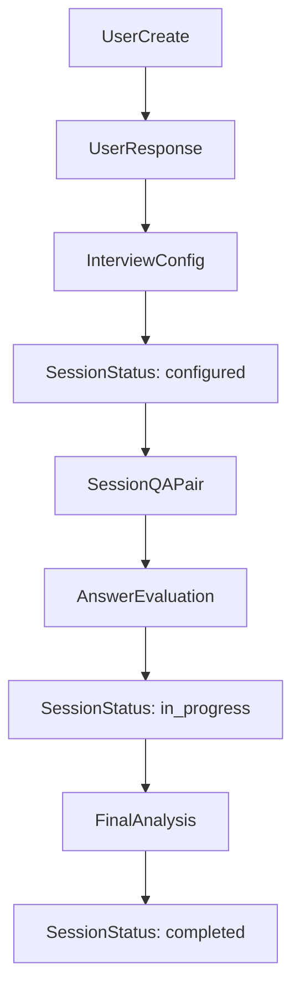

# Domain Entity Modeling

## System Role & Architectural Position

The Domain Entity Modeling layer defines the structured data contracts and persistence schemas that govern the PrepUp ecosystem. While implemented as Pydantic models for API validation and serialization, these schemas serve as the blueprint for the underlying SQLAlchemy relational mappings, ensuring strict type safety and domain invariant enforcement across the backend services.

This layer acts as the primary interface between the **AI Processing Pipeline** (which generates raw evaluations) and the **Domain Persistence & State** layer (which stores historical interview data). It enforces constraints on scoring (normalized $0.0$ to $1.0$), interview configurations, and user identity metadata.

### Domain Entity Specifications

| Entity | Responsibility | Primary Constraints | Persistence Mapping |
| :--- | :--- | :--- | :--- |
| `User` | Identity & Profile | Email unique, password $\ge 8$ chars | `users` table |
| `InterviewConfig` | Session Parameters | $\text{Question Count} \in [3, 30]$ | `sessions.config` (JSONB) |
| `SessionQAPair` | Per-question state | `question_index` $\ge 0$ | `session_qa` table |
| `AnswerEvaluation` | LLM-derived metrics | Score $\in [0.0, 1.0]$ | `session_qa.evaluation` (JSONB) |
| `FinalAnalysis` | Aggregate performance | Hire recommendation enum | `sessions.analysis` (JSONB) |

## Core Execution & Data Flow Mechanics

The domain models orchestrate a state-driven lifecycle for interview sessions. The flow transitions from a configuration state to an active dialogue, concluding with a comprehensive analytical synthesis.



### Data Transition Lifecycle
1.  **Initialization**: A `SessionCreateRequest` is validated against `InterviewConfig`. A session is instantiated with a `configured` status.
2.  **Interaction Loop**: For every turn in the interview:
    *   The system generates a `NextQuestionRequest`.
    *   The user's response is processed via the `TranscriptionResponse` contract.
    *   An `AnswerEvaluation` is generated by the LLM and persisted as a `SessionQAPair`.
3.  **Synthesis**: Upon reaching the `question_count` limit, the `FinalAnalysis` model aggregates `CategoryScores` across all `SessionQAPair` entries.
4.  **Termination**: The session state is updated to `completed`, and the `SessionResponse` is returned to the client for visualization.

## Implementation Deep Dive

The implementation utilizes Pydantic's `Field` for runtime validation of domain invariants. This prevents corrupted state (e.g., negative scores or empty transcriptions) from reaching the database.

### Session State Definition
The `SessionResponse` model serves as the aggregate root, encapsulating the configuration, the sequence of interactions, and the final results.

```python title="backend/app/models/session.py"
class SessionResponse(BaseModel):
	"""Primary session response model returned by session APIs."""

	id: str
	user_id: str
	status: SessionStatus
	config: InterviewConfig
	started_at: datetime | None = None
	ended_at: datetime | None = None
	duration_seconds: int = 0
	qa_pairs: list[SessionQAPair] = Field(default_factory=list)
	final_analysis: FinalAnalysis | None = Field(default=None)
	created_at: datetime
	updated_at: datetime
```
**Mechanics:**
- `status`: A `Literal` type ensuring the session only exists in one of four states: `configured`, `in_progress`, `completed`, or `abandoned`.
- `qa_pairs`: A collection of `SessionQAPair` objects, maintaining the temporal order of the interview via `question_index`.
- `final_analysis`: An optional field that remains `None` until the AI processing pipeline triggers the final synthesis.

### Analytical Scoring Schema
The scoring system is normalized to a float range of $[0, 1]$ to facilitate consistent visualization in the frontend Analytics Layer.

```python title="backend/app/models/analysis.py"
class CategoryScores(BaseModel):
	"""Category-wise scoring breakdown."""

	technical_accuracy: float = Field(..., ge=0.0, le=1.0)
	communication: float = Field(..., ge=0.0, le=1.0)
	problem_solving: float = Field(..., ge=0.0, le=1.0)
	depth_of_knowledge: float = Field(..., ge=0.0, le=1.0)
	confidence: float = Field(..., ge=0.0, le=1.0)
```
**Mechanics:**
- `ge=0.0, le=1.0`: Enforces strict boundaries at the Pydantic level, raising `ValidationError` if the LLM returns a score outside this range.
- **Dimensionality**: Breaks down the performance into five distinct vectors, allowing the `Analytics Visualization Layer` to render radar charts.

### Identity Security Mapping
The system separates public user profiles from internal security credentials using model inheritance.

```python title="backend/app/models/user.py"
class UserResponse(BaseModel):
	"""Safe user model returned by API endpoints."""

	id: str
	email: str
	full_name: str
	created_at: datetime
	updated_at: datetime

class UserInDB(UserResponse):
	"""Database model that includes internal-only security fields."""

	password_hash: str
```
**Mechanics:**
- `UserResponse`: The "Safe" projection used for API responses to prevent leaking sensitive hashes.
- `UserInDB`: Extends `UserResponse` to include `password_hash`, used exclusively by the `IAM Backend Services` for credential verification.

## Method / State Reference & Error Recovery

### Session Status State Machine

| State | Trigger | Allowed Transitions | Recovery Action |
| :--- | :--- | :--- | :--- |
| `configured` | `POST /sessions` | $\rightarrow$ `in_progress`, `abandoned` | Delete session if not started |
| `in_progress` | First Audio Upload | $\rightarrow$ `completed`, `abandoned` | Resume from last `question_index` |
| `completed` | Final Analysis Generated | $\text{Terminal State}$ | Read-only access |
| `abandoned` | User Exit/Timeout | $\text{Terminal State}$ | Archive session |

### Failure Modes & Validation Errors

| Error Scenario | Model Constraint | System Response | Recovery Path |
| :--- | :--- | :--- | :--- |
| Invalid Score | `ge=0.0, le=1.0` | `422 Unprocessable Entity` | LLM prompt retry or default to $0.0$ |
| Missing Transcript | `min_length=1` | `ValidationError` | Trigger audio re-upload/transcription |
| Invalid Hire Rec | `pattern="^(strong_hire\|...)$"` | `ValidationError` | Map LLM text to nearest enum value |
| Config Overflow | `le=30` (question_count) | `400 Bad Request` | Client-side validation on config form |