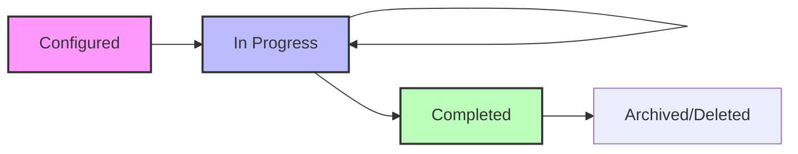

# Session Lifecycle Management

## System Role & Architectural Position

The Session Lifecycle Management module serves as the state orchestrator for interview sessions within PrepUp. It abstracts the persistence layer (MongoDB) to manage the transition of an interview from initial configuration to real-time transcription capture and final analytical evaluation. 

Positioned within the **Domain Persistence & State** layer, this module ensures that session data is isolated per user, maintains chronological integrity of Q&A pairs, and provides the necessary hooks for the AI Processing Pipeline to persist transient stream data into permanent records.

### Technical Specification: Session Entity Schema

| Field | Type | Constraint | Description |
| :--- | :--- | :--- | :--- |
| `_id` | `ObjectId` | Primary Key | Unique MongoDB identifier for the session. |
| `user_id` | `ObjectId` | Indexed / FK | Reference to the owning user for access control. |
| `status` | `String` | `enum` | Lifecycle state: `configured`, `in_progress`, `completed`. |
| `config` | `Object` | Required | JSON blob containing interview parameters (e.g., difficulty, role). |
| `qa_pairs` | `Array<Object>` | Ordered | Sequence of question/answer objects with transcription and evaluation. |
| `started_at` | `DateTime` | Nullable | UTC timestamp marking the first transcript entry. |
| `ended_at` | `DateTime` | Nullable | UTC timestamp marking the final analysis commit. |
| `final_analysis`| `Object` | Nullable | Aggregated performance metrics and AI-generated feedback. |

## Core Execution & Data Flow Mechanics

The session lifecycle follows a strict linear state transition model. State transitions are triggered by specific service method invocations, moving the session from a latent configuration to an active state, and finally to a read-only analyzed state.

### Lifecycle State Transition Diagram



### Data Persistence Flow: Transcript Upsertion

When the AI pipeline captures a user response, the `upsert_transcript_answer` method is invoked. This is the most critical write operation in the lifecycle:

1.  **Identity Validation**: Converts string `user_id` and `session_id` to `ObjectId`.
2.  **State Recovery**: Retrieves the current `qa_pairs` array to determine the `resolved_question_index`.
3.  **Payload Construction**: Encapsulates the transcription, question text, and duration into a standardized Q&A object.
4.  **Atomic Update**: Uses MongoDB `$set` to push the new Q&A pair and simultaneously transition the session status to `in_progress` and update `started_at` if it is currently null.

## Implementation Deep Dive & Code Snippets

### Backend Service Logic: Atomic State Updates

The `SessionService` implements the business logic, ensuring that no session is modified without verifying ownership via `user_id`.

```python title="backend/app/services/session_service.py"
async def upsert_transcript_answer(
    self,
    user_id: str,
    session_id: str,
    question_index: int | None,
    transcription: str,
    question_text: str | None = None,
    question_type: str = "opening",
    recorded_duration_seconds: float | None = None,
) -> int:
    user_object_id = self._to_object_id(user_id)
    session_object_id = self._to_object_id(session_id)
    now = datetime.now(timezone.utc)

    session_doc = await self.collection.find_one(
        {"_id": session_object_id, "user_id": user_object_id}
    )
    if session_doc is None:
        raise NotFoundError("Session")

    qa_pairs = list(session_doc.get("qa_pairs", []))
    resolved_question_index = question_index if question_index is not None else len(qa_pairs)
    
    payload = {
        "question_index": resolved_question_index,
        "question": question_text,
        "question_type": question_type,
        "transcription": transcription,
        "recorded_duration_seconds": recorded_duration_seconds,
        "evaluation": None,
        "created_at": now,
    }

    qa_pairs.append(payload)

    await self.collection.update_one(
        {"_id": session_object_id, "user_id": user_object_id},
        {
            "$set": {
                "qa_pairs": qa_pairs,
                "status": "in_progress",
                "started_at": session_doc.get("started_at") or now,
                "updated_at": now,
            }
        },
    )
    return resolved_question_index
```

**Mechanics:**
- **Complexity**: $O(1)$ for the update, but $O(N)$ for retrieving the `qa_pairs` list where $N$ is the number of questions.
- **Consistency**: The use of `user_id` in the `update_one` filter prevents cross-tenant data leakage.
- **State Side-Effect**: Automatically upgrades session status to `in_progress` upon the first answer submission.

### Frontend API Abstraction

The frontend interacts with the session lifecycle through a typed API wrapper, ensuring type safety for request and response payloads.

```typescript title="frontend/src/api/sessions.ts"
export const sessionsApi = {
    createSession: async (payload: SessionCreateRequest): Promise<SessionResponse> => {
        const { data } = await apiClient.post<SessionResponse>('/sessions', payload)
        return data
    },

    listSessions: async (params: ListSessionsParams = {}): Promise<SessionListResponse> => {
        const { data } = await apiClient.get<SessionListResponse>('/sessions', { params })
        return data
    },

    getSessionById: async (sessionId: string): Promise<SessionResponse> => {
        const { data } = await apiClient.get<SessionResponse>(`/sessions/${sessionId}`)
        return data
    },

    deleteSession: async (sessionId: string): Promise<void> => {
        await apiClient.delete(`/sessions/${sessionId}`)
    },
} as const
```

**Mechanics:**
- **Interface**: Uses `apiClient` (Axios instance) for centralized header management (JWT injection).
- **Pagination**: `listSessions` supports `skip` and `limit` parameters to handle large session histories efficiently.

### Route Orchestration

The FastAPI router handles dependency injection for database handles and authentication.

```python title="backend/app/routers/sessions.py"
@router.post("", response_model=SessionResponse, status_code=status.HTTP_201_CREATED)
async def create_session(
    payload: SessionCreateRequest,
    current_user: UserResponse = Depends(get_current_user),
    db: AsyncIOMotorDatabase = Depends(get_db),
) -> SessionResponse:
    """Create a new configured interview session for the authenticated user."""
    service = SessionService(db)
    return await service.create_session(current_user.id, payload)
```

**Mechanics:**
- **Auth Guard**: `get_current_user` ensures only authenticated requests reach the service layer.
- **DI Pattern**: `get_db` injects the `AsyncIOMotorDatabase` instance, facilitating easier unit testing via database mocking.

## Method / State Reference & Error Recovery

### Service Method Reference

| Method | Params | Return | Logic |
| :--- | :--- | :--- | :--- |
| `create_session` | `user_id`, `payload` | `SessionResponse` | Initializes doc with `status="configured"`. |
| `list_sessions` | `user_id`, `skip`, `limit` | `SessionListResponse` | Sorted by `created_at` DESC; paginated. |
| `get_session_by_id`| `user_id`, `session_id` | `SessionResponse` | Strict owner check via `user_id`. |
| `set_final_analysis`| `user_id`, `session_id`, `analysis` | `None` | Sets `status="completed"` and `ended_at`. |
| `update_qa_pair_evaluation`| `user_id`, `session_id`, `idx`, `eval` | `None` | Updates specific array element using dot notation. |

### Failure Modes & Recovery

| Failure Scenario | Trigger | System Response | Recovery/Resolution |
| :--- | :--- | :--- | :--- |
| **Invalid ID Format** | Malformed `session_id` string. | `NotFoundError("Session")` | `_to_object_id` catches `bson.errors.InvalidId` and raises a 404. |
| **Unauthorized Access**| User requests session belonging to another ID. | `NotFoundError("Session")` | The query `{"_id": sid, "user_id": uid}` returns `None`, masking existence for security. |
| **Race Condition** | Concurrent `upsert_transcript_answer` calls. | Last-write-wins | `qa_pairs` are fetched, appended, and rewritten. High-concurrency requires `$push` operator. |
| **DB Connection Loss**| Motor driver timeout. | `HTTP 500 Internal Server Error` | Handled by global exception handler defined in the Backend Core Engine. |