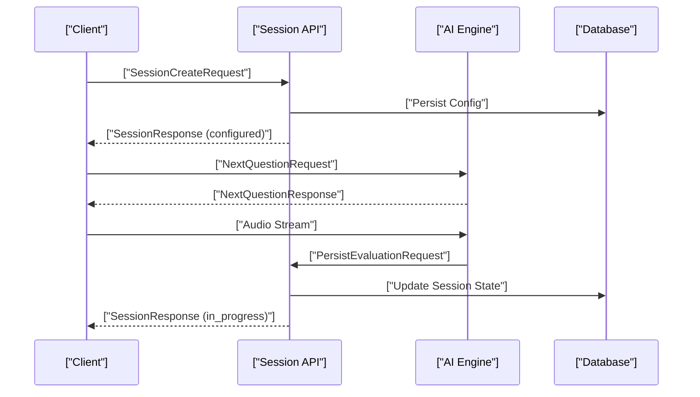

# Domain Persistence & State

The Domain Persistence & State layer serves as the authoritative source of truth for the PrepUp ecosystem. It orchestrates the transition of volatile interview data (real-time audio and streaming transcripts) into structured, immutable historical records. This layer is architected around three distinct data planes: **Identity** (User management), **Transaction** (Interview session lifecycles), and **Intelligence** (Derived analytical insights).

## Section A: System Role & Architectural Position

This layer sits between the **Identity & Access Management (IAM)** layer and the **AI Processing Pipeline**. While the AI engine generates transient intelligence, the Domain Persistence layer ensures that these insights are mapped to specific users and session contexts via strictly typed Pydantic schemas that mirror the relational database constraints.

### Data Plane Mapping

| Plane | Primary Entity | Persistence Driver | Data Characteristics |
| :--- | :--- | :--- | :--- |
| **Identity** | `User` | Relational DB (SQLAlchemy) | Low volatility; high security requirements. |
| **Transaction** | `Session` | Relational DB / Redis Cache | High volatility; state-machine driven lifecycle. |
| **Intelligence** | `Analysis` | Relational DB (JSONB/Relational) | Derived data; high density; analytical focus. |

## Section B: Core Execution & Data Flow Mechanics

The movement of data follows a strictly defined lifecycle, moving from user-defined configurations to high-fidelity evaluations. The system employs a state-machine pattern to manage the `SessionStatus`, preventing illegal transitions (e.g., moving from `completed` back to `in_progress`).

### Session Lifecycle Sequence



### Execution Logic Flow

1.  **Initialization Phase**: The client submits an `InterviewConfig`. The system validates constraints (e.g., `question_count` between 3 and 30) and persists a `SessionResponse` with status `configured`.
2.  **Iterative Interview Loop**: 
    *   The AI engine generates questions based on `domain`, `role`, and `difficulty`.
    *   Audio is captured and normalized (see `AudioNormalizationMetadata`).
    *   Upon completion of an answer, a `PersistEvaluationRequest` is dispatched.
3.  **Terminal Analysis Phase**: Once the `question_count` is reached or the session is `abandoned`, the `FinalAnalysis` model is instantiated, aggregating all `AnswerEvaluation` objects into a comprehensive `CategoryScores` breakdown.

## Section C: Implementation Deep Dive

### Core Session Schema

The `SessionResponse` is the central aggregate root. It encapsulates the session's metadata, the configuration that drove the interview, and the collection of granular question-answer pairs.

```python title="backend/app/models/session.py"
class SessionResponse(BaseModel):
    """Primary session response model returned by session APIs."""
    id: str
    user_id: str
    status: SessionStatus
    config: InterviewConfig
    started_at: datetime | None = None
    ended_at: datetime | None = None
    duration_seconds: int = 0
    qa_pairs: list[SessionQAPair] = Field(default_factory=list)
    final_analysis: FinalAnalysis | None = Field(default=None)
    created_at: datetime
    updated_at: datetime
```

**Mechanics:**
*   **`qa_pairs`**: An ordered list of `SessionQAPair` objects, ensuring the chronological integrity of the interview.
*   **`status`**: Controlled via `SessionStatus` literal to enforce strict state transitions in the service layer.
*   **`final_analysis`**: A nullable field that only populates when the session transitions to `completed`.

### Analytical Contract

The intelligence layer relies on the `AnswerEvaluation` model to quantify qualitative human speech. This model is used both for real-time feedback and for the final aggregate scoring.

```python title="backend/app/models/analysis.py"
class AnswerEvaluation(BaseModel):
    """Evaluation metrics for a single answer."""
    score: float = Field(..., ge=0.0, le=1.0)
    strengths: list[str] = Field(default_factory=list)
    weaknesses: list[str] = Field(default_factory=list)
    feedback: str = Field(..., min_length=10)
    keywords_mentioned: list[str] = Field(default_factory=list)
    keywords_missed: list[str] = Field(default_factory=list)
```

**Mechanics:**
*   **`score`**: A normalized float $[0.0, 1.0]$ allowing for easy aggregation into `overall_score`.
*   **Keyword Tracking**: `keywords_mentioned` vs `keywords_missed` provides the data foundation for the "Depth of Knowledge" metric in the `CategoryScores` model.
*   **Constraint Enforcement**: `min_length=10` on `feedback` ensures the LLM provides sufficient semantic value before the data is persisted.

## Section D: Method / State Reference & Error Recovery

### Session Status State Machine

| Current State | Allowed Transition | Triggering Action |
| :--- | :--- | :--- |
| `configured` | `in_progress` | First question generation/session start. |
| `in_progress` | `completed` | All questions answered or session end signal. |
| `in_progress` | `abandoned` | User disconnect or system timeout. |
| `completed` | *None* | Terminal state. |
| `abandoned` | *None* | Terminal state. |

### Error Recovery & Validation Failures

The system utilizes Pydantic's strict validation to catch data corruption at the API boundary.

| Failure Mode | Detection Layer | Recovery Strategy |
| :--- | :--- | :--- |
| **Invalid Auth Token** | `IAM Backend Services` | Return `401 Unauthorized`; force client re-authentication. |
| **Malformed Audio** | `TranscriptionResponse` | Return `TranscriptionErrorResponse` with `retryable: true`. |
| **Out-of-Bounds Score** | `AnswerEvaluation` | `ValidationError` raised; prevent persistence to DB to maintain data integrity. |
| **Session Timeout** | `Session Lifecycle` | Transition status to `abandoned` and persist partial `qa_pairs`. |