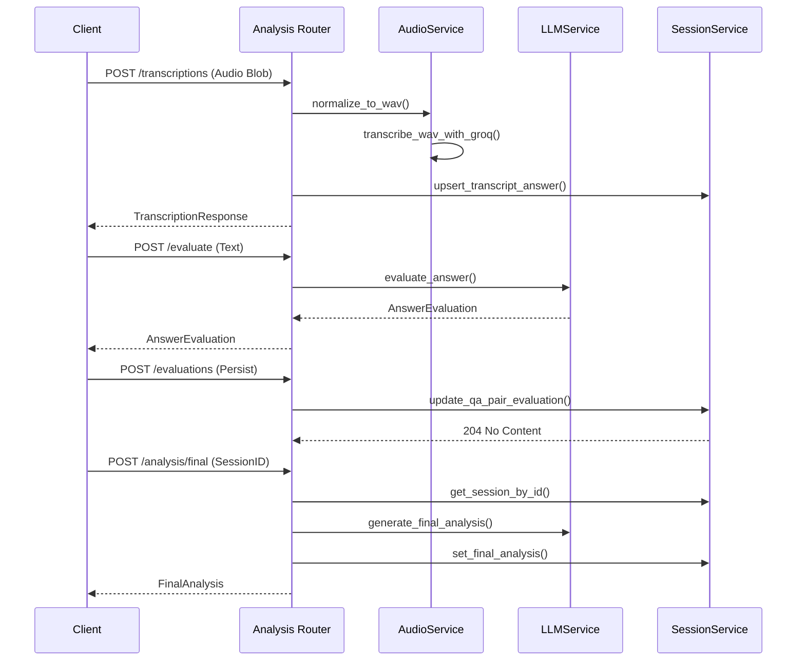

# Analysis Processing Pipeline

The Analysis Processing Pipeline is the server-side engine responsible for transforming raw multimodal user input (audio) into structured performance metrics. It orchestrates a three-stage lifecycle: audio-to-text transcription, real-time answer evaluation, and aggregate session synthesis. This pipeline leverages a combination of high-performance audio normalization, Groq-based transcription, and LLM-driven categorical analysis to derive competency scores across specific professional domains.

## System Role & Architectural Position

The pipeline operates as the bridge between the **AI Processing Pipeline** (which handles real-time interaction) and the **Domain Persistence & State** layer. It transforms transient interaction data into permanent analytical records stored in MongoDB.

### Component Dependency Matrix

| Dependency | Role | Interaction Type | Criticality |
| :--- | :--- | :--- | :--- |
| `AudioService` | Signal processing, WAV normalization, and Groq API orchestration. | Synchronous/Await | High |
| `LLMService` | Prompt engineering for evaluation, question generation, and final synthesis. | Asynchronous API | High |
| `SessionService` | Persistence of transcripts and evaluation objects in MongoDB. | CRUD (Motor) | High |
| `FastAPI Router` | Request validation, multipart form parsing, and HTTP status mapping. | Interface | Medium |

## Core Execution & Data Flow Mechanics

The pipeline processes data through a linear progression of refinement: **Raw Audio $\rightarrow$ Normalized Wav $\rightarrow$ Transcription $\rightarrow$ Evaluation $\rightarrow$ Final Analysis**.

### Analysis Workflow Sequence



### Execution Key Points
*   **Atomic Transcription**: Audio is processed as a `multipart/form-data` request. The `AudioService` ensures the payload is valid and converted to a standardized WAV format before invoking the transcription provider to minimize latency and maximize accuracy.
*   **Decoupled Evaluation**: Evaluation occurs independently of transcription. This allows the frontend to control when to trigger an evaluation, enabling a "review-then-evaluate" UX pattern.
*   **Stateful Aggregation**: The final analysis is not a simple average of scores; it is a synthetic review generated by the `LLMService` after consuming the entire history of `qa_pairs` and their corresponding evaluations.

## Implementation Deep Dive

### Audio Ingestion & Transcription Pipeline
The `/transcriptions` endpoint implements a rigorous validation and normalization sequence. It prevents corrupted or incompatible audio formats from reaching the transcription provider.

```python title="backend/app/routers/analysis.py"
try:
    audio_bytes = await audio_file.read()
    audio_service.ensure_audio_payload_is_valid(
        audio_bytes=audio_bytes,
        mime_type=mime_type,
        recorded_duration_ms=recorded_duration_ms,
    )
    normalized_audio = audio_service.normalize_to_wav(
        audio_bytes=audio_bytes,
        mime_type=mime_type,
    )
    transcription_result = await audio_service.transcribe_wav_with_groq(
        normalized_audio.wav_bytes
    )

    if session_id is not None:
        session_service = SessionService(db)
        stored_question_index = await session_service.upsert_transcript_answer(
            user_id=current_user.id,
            session_id=session_id,
            question_index=question_index,
            transcription=transcription_result.transcript_text,
            question_text=question_text,
            question_type=question_type,
            recorded_duration_seconds=normalized_audio.duration_seconds,
        )
```
**Mechanics:**
1.  **`ensure_audio_payload_is_valid`**: Validates byte length and MIME types to prevent `413 Request Entity Too Large` or `400 Bad Request` errors during processing.
2.  **`normalize_to_wav`**: Standardizes audio sampling rate and bit depth, ensuring compatibility with the Groq STT (Speech-to-Text) engine.
3.  **`upsert_transcript_answer`**: Performs an atomic update in MongoDB, mapping the transcription to a specific `question_index` within a `session_id`.

### Final Analysis Synthesis
The `generate_final_analysis` handler aggregates session data to produce a holistic competency report.

```python title="backend/app/routers/analysis.py"
@router.post("/analysis/final", response_model=FinalAnalysis)
async def generate_final_analysis(
    session_id: str,
    current_user: UserResponse = Depends(get_current_user),
    db: AsyncIOMotorDatabase = Depends(get_db),
) -> FinalAnalysis | JSONResponse:
    session_service = SessionService(db)
    session = await session_service.get_session_by_id(current_user.id, session_id)

    llm_service = LLMService()
    qa_list = [
        {
            "question": pair.question or "N/A",
            "transcription": pair.transcription,
            "evaluation": pair.evaluation.model_dump() if pair.evaluation else {},
        }
        for pair in session.qa_pairs
    ]
    all_scores = [
        pair.evaluation.score for pair in session.qa_pairs if pair.evaluation
    ]

    final_analysis = await llm_service.generate_final_analysis(
        domain=session.config.domain,
        role=session.config.role,
        interview_type=session.config.interview_type,
        qa_pairs=qa_list,
        all_scores=all_scores,
    )

    await session_service.set_final_analysis(current_user.id, session_id, final_analysis)
    return final_analysis
```
**Mechanics:**
1.  **Data Collection**: Extracts all `qa_pairs` from the session document, flattening evaluations and transcripts into a format digestible by the LLM.
2.  **Score Extraction**: Creates a numerical list (`all_scores`) to provide the LLM with quantitative context alongside qualitative data.
3.  **Synthetic Generation**: The `LLMService` processes this context to identify patterns, strengths, and weaknesses.
4.  **Persistence**: The final report is persisted back to the session document to prevent redundant LLM calls for the same session.

### Frontend API Interface
The frontend communicates with the pipeline using a typed Axios wrapper, ensuring that `multipart/form-data` is handled correctly for audio blobs.

```typescript title="frontend/src/api/analysis.ts"
export async function createTranscription(
    input: TranscriptionRequestInput,
): Promise<TranscriptionResponse> {
    const formData = new FormData()

    if (input.audioBlob) {
        formData.append('audio_file', input.audioBlob, 'recording.webm')
    }
    // ... other appends (session_id, question_index, etc.)

    try {
        const response = await apiClient.post<TranscriptionResponse>(
            '/analysis/transcriptions',
            formData,
            { headers: { 'Content-Type': 'multipart/form-data' } },
        )
        return response.data
    } catch (error) {
        const typedError = error as AxiosError<TranscriptionErrorResponse>
        if (typedError.response?.data) throw typedError.response.data
        throw error
    }
}
```
**Mechanics:**
1.  **FormData Construction**: Explicitly appends the `audioBlob` as a file, which is required by FastAPI's `UploadFile` type.
2.  **Error Mapping**: Specifically catches `AxiosError` and unwraps the `TranscriptionErrorResponse` to propagate backend-defined error codes (e.g., `MIC_PERMISSION_DENIED`) to the UI.

## Method / State Reference & Error Recovery

### API Endpoint Registry

| Endpoint | Method | Input | Output | Primary Logic |
| :--- | :--- | :--- | :--- | :--- |
| `/analysis/transcriptions` | `POST` | `Multipart Form` | `TranscriptionResponse` | Audio $\rightarrow$ Text |
| `/analysis/questions/generate` | `POST` | `QuestionGenerationRequest` | `QuestionGenerationResponse` | Seed Question Set |
| `/analysis/questions/next` | `POST` | `NextQuestionRequest` | `NextQuestionResponse` | Dynamic Questioning |
| `/analysis/evaluate` | `POST` | `Query Params` | `AnswerEvaluation` | Answer Scoring |
| `/analysis/evaluations` | `POST` | `PersistEvaluationRequest` | `204 No Content` | DB Persistence |
| `/analysis/analysis/final` | `POST` | `session_id` (Param) | `FinalAnalysis` | Session Synthesis |

### Failure Modes & Recovery

The pipeline implements a specific mapping for audio-related failures to provide granular client-side feedback via `_status_code_for_error`.

| Error Code | HTTP Status | Recovery Strategy |
| :--- | :--- | :--- |
| `INVALID_AUDIO_BYTES` | `400` | Prompt user to re-record; check audio hardware. |
| `INVALID_AUDIO_SIZE` | `413` | Truncate audio blob on client-side before upload. |
| `AUDIO_CONVERSION_TIMEOUT` | `504` | Exponential backoff retry of the upload. |
| `TRANSCRIPTION_PROVIDER_FAILURE`| `502` | Fallback to secondary STT provider or notify user of service outage. |
| `MIC_PERMISSION_DENIED` | `400` | Trigger browser permission request flow. |