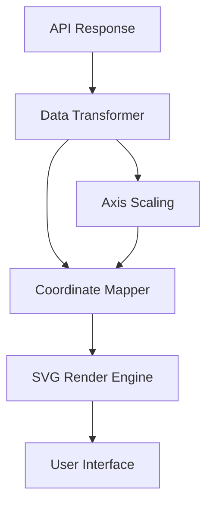

# Analytics Visualization Layer

## System Role & Architectural Position

The Analytics Visualization Layer serves as the high-fidelity presentation tier for the Analytics & Evaluation Engine. Its primary objective is to transform raw, normalized performance metrics—generated by the `AnalysisProcessingPipeline`—into multi-dimensional visual representations. This layer operates as a set of stateless functional components that map complex JSON telemetry into SVG-based visualizations.

Architecturally, this layer sits at the edge of the frontend, consuming processed evaluation data from the Domain Persistence layer via REST/WebSocket interfaces. It abstracts the underlying data complexity (e.g., weighted averages, temporal distributions) into visual cues for user progress tracking and skill gap analysis.

### Technical Specification & Dependencies

| Specification | Detail | Dependency / Constraint |
| :--- | :--- | :--- |
| **Rendering Engine** | SVG / HTML5 Canvas | `recharts`, `framer-motion` |
| **Data Input Format** | Normalized JSON Arrays | `AnalysisResult` Type Interface |
| **Time Complexity** | $O(N)$ for data transformation | $N$ = number of data points per series |
| **State Management** | Unidirectional Data Flow | Props-driven (Stateless) |
| **Styling Paradigm** | Utility-first Atomic CSS | `tailwind-css` |

## Core Execution & Data Flow Mechanics

The visualization layer follows a strict pipeline: **Data Acquisition $\rightarrow$ Normalization $\rightarrow$ Coordinate Mapping $\rightarrow$ SVG Rendering**.

Data originates in the `AnalysisProcessingPipeline` (Backend), where interview transcripts are scored. This data is transmitted as a series of scalar values and categorical mappings. The visualization components perform a final transformation to align these values with the axes of the specific chart type (e.g., Polar coordinates for Radar, Cartesian for Line/Bar).



### Key Operational Invariants
*   **Normalization**: All input scores are expected to be normalized to a $[0, 1]$ or $[0, 100]$ scale to ensure consistent axis scaling across different user profiles.
*   **Temporal Aggregation**: For the `HeatmapCalendar`, raw timestamps are aggregated into daily buckets using an ISO-8601 mapping key.
*   **Dimensionality**: The `ScoreRadar` requires a fixed dimensionality (e.g., 5-8 skill vectors) to maintain the geometric integrity of the polygon.

## Implementation Deep Dive & Code Snippets

### Multi-Dimensional Skill Mapping (`ScoreRadar`)
The `ScoreRadar` component implements a polar coordinate system to visualize skill distribution. It maps categorical performance metrics (e.g., "Technical Accuracy," "Communication") to vertices of a regular polygon.

```typescript title="frontend/src/components/charts/ScoreRadar.tsx"
interface RadarData {
  subject: string;
  A: number; // Full mark (100)
  fullMark: number;
}

const ScoreRadar = ({ data }: { data: RadarData[] }) => {
  return (
    <ResponsiveContainer width="100%" height={400}>
      <RadarChart cx="50%" cy="50%" outerRadius="80%" data={data}>
        <PolarGrid gridType="polygon" />
        <PolarAngleAxis dataKey="subject" />
        <PolarRadiusAxis angle={30} domain={[0, 100]} />
        <Radar
          name="User Performance"
          dataKey="A"
          stroke="#8884d8"
          fill="#8884d8"
          fillOpacity={0.6}
        />
      </RadarChart>
    </ResponsiveContainer>
  );
};
```
**Mechanics:**
1.  **PolarGrid**: Defines the concentric polygons representing score thresholds.
2.  **PolarAngleAxis**: Maps the `subject` string to a specific angle $\theta$ around the center.
3.  **PolarRadiusAxis**: Sets the radial distance $r$ based on the normalized score $[0, 100]$.

### Temporal Activity Tracking (`HeatmapCalendar`)
The `HeatmapCalendar` processes a time-series of activity logs, transforming a flat list of interview dates into a 2D grid representing the calendar year.

```typescript title="frontend/src/components/charts/HeatmapCalendar.tsx"
type ActivityPoint = {
  date: string; // ISO Format: YYYY-MM-DD
  count: number;
};

const getColorIntensity = (count: number) => {
  if (count === 0) return 'bg-gray-100';
  if (count < 3) return 'bg-green-200';
  if (count < 6) return 'bg-green-400';
  return 'bg-green-600';
};

// Logic for rendering the grid
const renderGrid = (data: ActivityPoint[]) => {
  return daysInYear.map(day => {
    const activity = data.find(p => p.date === day);
    return <div className={`w-3 h-3 ${getColorIntensity(activity?.count || 0)}`} />;
  });
};
```
**Mechanics:**
1.  **Temporal Bucket**: Uses a `find` operation (or Map lookup) to correlate a specific calendar date with activity counts.
2.  **Intensity Mapping**: A discrete step function `getColorIntensity` maps scalar counts to Tailwind CSS color classes, providing immediate visual density feedback.

### Performance Trend Analysis (`ProgressLine`)
The `ProgressLine` component tracks a specific metric (e.g., "Average Score") across multiple sessions to visualize growth trajectories.

```typescript title="frontend/src/components/charts/ProgressLine.tsx"
const ProgressLine = ({ sessions }: { sessions: { date: string, score: number }[] }) => {
  return (
    <LineChart data={sessions}>
      <CartesianGrid strokeDasharray="3 3" vertical={false} />
      <XAxis dataKey="date" tickFormatter={(str) => formatDate(str)} />
      <YAxis domain={[0, 100]} />
      <Tooltip content={<CustomTooltip />} />
      <Line 
        type="monotone" 
        dataKey="score" 
        stroke="#3b82f6" 
        strokeWidth={3} 
        dot={{ r: 4 }} 
        activeDot={{ r: 6 }} 
      />
    </LineChart>
  );
};
```
**Mechanics:**
1.  **Monotone Interpolation**: Uses cubic spline interpolation (`type="monotone"`) to smooth the transition between discrete session points.
2.  **Axis Constraints**: The Y-axis is hard-clamped to $[0, 100]$ to prevent the chart from auto-scaling, which would otherwise mislead the user regarding the magnitude of progress.

## Method / State Reference & Error Recovery

### Component Parameter Contracts

| Component | Prop | Type | Description | Default |
| :--- | :--- | :--- | :--- | :--- |
| `ScoreRadar` | `data` | `RadarData[]` | Array of skill-score pairs. | `[]` |
| `ProgressLine` | `sessions` | `SessionScore[]` | Time-series of scores. | `[]` |
| `HeatmapCalendar`| `activity` | `ActivityPoint[]` | Daily interaction counts. | `[]` |
| `CategoryBar` | `metrics` | `BarMetric[]` | Comparative category scores. | `[]` |

### Failure Modes & Recovery

| Failure Mode | Root Cause | Recovery Strategy |
| :--- | :--- | :--- |
| **Empty Data State** | No interview sessions completed. | Render `EmptyState` skeleton with a "Start First Interview" CTA. |
| **Out-of-Bounds Value** | Backend returned score $> 100$ or $< 0$. | Implement `Math.clamp(val, 0, 100)` in the data transformer layer. |
| **Missing Date Keys** | API returned null for specific temporal buckets. | Default to `0` activity using nullish coalescing (`?? 0`). |
| **Dimension Mismatch** | Radar chart receiving inconsistent skill sets. | Enforce a `SchemaValidator` that filters data to only include predefined skill keys. |