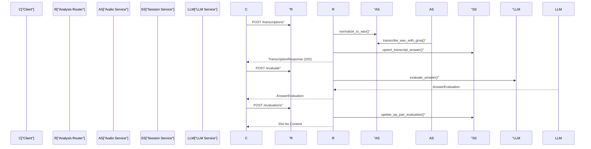

# Analytics & Evaluation Engine

The Analytics & Evaluation Engine serves as the intelligence layer of the PrepUp ecosystem. It transforms raw multimodal interview data—specifically browser-captured audio streams—into quantized performance metrics and qualitative feedback. The engine orchestrates a complex pipeline involving audio normalization, speech-to-text (STT) transcription via Groq, and multi-stage LLM evaluation for both real-time feedback and post-session synthesis.

## System Role & Architectural Position

The engine operates as a middleware processor between the AI Processing Pipeline (which handles the live interaction) and the Domain Persistence layer (which stores the session state). It is responsible for the transition of data from ephemeral audio blobs to structured JSON evaluations.

### Component Dependency Specification

| Dependency | Role | Integration Point | Interaction Type |
| :--- | :--- | :--- | :--- |
| `AudioService` | Signal Processing | `transcribe_audio` | Synchronous Normalization $\rightarrow$ Async Transcription |
| `LLMService` | Cognitive Analysis | `evaluate_answer` / `generate_final_analysis` | Prompt-based Inference |
| `SessionService` | State Persistence | `upsert_transcript_answer` / `update_qa_pair_evaluation` | MongoDB CRUD Operations |
| `Groq API` | STT Inference | `audio_service.transcribe_wav_with_groq` | External REST API |

## Core Execution & Data Flow Mechanics

The engine implements two primary processing loops: the **Iterative Evaluation Loop** (per question) and the **Synthesis Loop** (per session).

### Iterative Evaluation Workflow

The following sequence illustrates the lifecycle of a single interview response, from audio capture to persistent evaluation.



### Key Processing Invariants
*   **Audio Normalization**: All incoming browser audio (typically `.webm` or `.ogg`) must be normalized to `.wav` via `AudioService` before being dispatched to the STT provider to ensure sample rate consistency.
*   **Stateless Evaluation**: The `/evaluate` endpoint is designed as a functional transformation: `(Question, Answer, Role, Domain) -> Evaluation`. State is only introduced during the explicit `/evaluations` persistence call.
*   **Adaptive Questioning**: The `generate_next_question` logic consumes the `current_score` and `conversation_summary`, allowing the LLM to dynamically adjust difficulty based on the user's real-time performance.

## Implementation Deep Dive

### Audio Ingestion and Transcription
The transcription route handles the critical transition from binary audio data to structured text. It implements strict validation to prevent processing of corrupted or empty payloads.

```python title="backend/app/routers/analysis.py"
@router.post(
    "/transcriptions",
    response_model=TranscriptionResponse,
    status_code=status.HTTP_202_ACCEPTED,
)
async def transcribe_audio(
    audio_file: UploadFile | None = File(default=None),
    session_id: str | None = Form(default=None),
    question_index: int | None = Form(default=None, ge=0),
    question_text: str | None = Form(default=None),
    question_type: str = Form(default="opening"),
    recorded_duration_ms: int | None = Form(default=None, ge=1),
    capture_error: str | None = Form(default=None),
    current_user: UserResponse = Depends(get_current_user),
    db: AsyncIOMotorDatabase = Depends(get_db),
) -> TranscriptionResponse | JSONResponse:
    # ... (Error handling for MIC_PERMISSION_DENIED and audio_file existence)
    
    try:
        audio_bytes = await audio_file.read()
        audio_service.ensure_audio_payload_is_valid(
            audio_bytes=audio_bytes,
            mime_type=mime_type,
            recorded_duration_ms=recorded_duration_ms,
        )
        normalized_audio = audio_service.normalize_to_wav(
            audio_bytes=audio_bytes,
            mime_type=mime_type,
        )
        transcription_result = await audio_service.transcribe_wav_with_groq(
            normalized_audio.wav_bytes
        )

        if session_id is not None:
            session_service = SessionService(db)
            await session_service.upsert_transcript_answer(
                user_id=current_user.id,
                session_id=session_id,
                question_index=question_index,
                transcription=transcription_result.transcript_text,
                # ... metadata
            )
        # ... return TranscriptionResponse
```

**Mechanics:**
1.  **Binary Validation**: `ensure_audio_payload_is_valid` checks the byte length against `recorded_duration_ms` to detect premature stream termination.
2.  **Normalization**: `normalize_to_wav` converts varying browser formats to a standardized WAV format required by Groq.
3.  **Asynchronous Upsert**: The transcription is persisted to MongoDB via `SessionService` immediately after STT completion, ensuring that if the subsequent evaluation fails, the transcript is already secured.

### Client-Side API Orchestration
The frontend abstracts the complex multipart requirements and LLM interaction patterns into a clean TypeScript interface.

```typescript title="frontend/src/api/analysis.ts"
export async function createTranscription(
    input: TranscriptionRequestInput,
): Promise<TranscriptionResponse> {
    const formData = new FormData()

    if (input.audioBlob) {
        formData.append('audio_file', input.audioBlob, 'recording.webm')
    }
    // ... other metadata appends (session_id, question_index, etc.)

    try {
        const response = await apiClient.post<TranscriptionResponse>(
            '/analysis/transcriptions',
            formData,
            { headers: { 'Content-Type': 'multipart/form-data' } },
        )
        return response.data
    } catch (error) {
        const typedError = error as AxiosError<TranscriptionErrorResponse>
        if (typedError.response?.data) throw typedError.response.data
        throw error
    }
}
```

**Mechanics:**
1.  **FormData Encapsulation**: Since the endpoint requires both a file (`UploadFile`) and metadata (`Form`), `FormData` is used to facilitate `multipart/form-data` encoding.
2.  **Error Propagation**: The `AxiosError` is cast to `TranscriptionErrorResponse` to preserve the custom error codes (e.g., `MIC_PERMISSION_DENIED`) sent by the backend.

### Final Analysis Synthesis
The synthesis phase aggregates all session data to produce a global performance report.

```python title="backend/app/routers/analysis.py"
@router.post("/analysis/final", response_model=FinalAnalysis)
async def generate_final_analysis(
    session_id: str,
    current_user: UserResponse = Depends(get_current_user),
    db: AsyncIOMotorDatabase = Depends(get_db),
) -> FinalAnalysis | JSONResponse:
    session = await session_service.get_session_by_id(current_user.id, session_id)
    
    qa_list = [
        {
            "question": pair.question or "N/A",
            "transcription": pair.transcription,
            "evaluation": pair.evaluation.model_dump() if pair.evaluation else {},
        }
        for pair in session.qa_pairs
    ]
    all_scores = [pair.evaluation.score for pair in session.qa_pairs if pair.evaluation]

    final_analysis = await llm_service.generate_final_analysis(
        domain=session.config.domain,
        role=session.config.role,
        interview_type=session.config.interview_type,
        qa_pairs=qa_list,
        all_scores=all_scores,
    )
    await session_service.set_final_analysis(current_user.id, session_id, final_analysis)
    return final_analysis
```

**Mechanics:**
1.  **Data Aggregation**: It transforms the MongoDB `qa_pairs` list into a simplified dictionary format suitable for LLM context window injection.
2.  **Score Distribution**: By extracting `all_scores`, the LLM can identify trends (e.g., consistent failure in "System Design" vs. "Coding").
3.  **Final State Mutation**: The `set_final_analysis` call marks the session as completed and attaches the final report to the session document.

## Method & State Reference

### API Contract: Analysis Endpoints

| Endpoint | Method | Input | Key Output | Complexity |
| :--- | :--- | :--- | :--- | :--- |
| `/analysis/transcriptions` | `POST` | `audio_file`, `session_id` | `transcript_text`, `request_id` | $O(AudioSize)$ |
| `/analysis/questions/generate` | `POST` | `domain`, `role`, `difficulty` | `List[Question]` | $O(LLM\_Inference)$ |
| `/analysis/evaluate` | `POST` | `question`, `answer` | `AnswerEvaluation` (Score/Feedback) | $O(LLM\_Inference)$ |
| `/analysis/evaluations` | `POST` | `session_id`, `evaluation` | `204 No Content` | $O(1)$ DB Write |
| `/analysis/analysis/final` | `POST` | `session_id` | `FinalAnalysis` (Comprehensive) | $O(N\_Questions)$ |

### Error Recovery & Failure Modes

The engine uses a specific mapping to translate internal `AudioProcessingError` codes into HTTP semantics.

| Internal Error Code | HTTP Status | Recovery Strategy |
| :--- | :--- | :--- |
| `MIC_PERMISSION_DENIED` | `400 Bad Request` | Prompt user to enable browser permissions. |
| `INVALID_AUDIO_BYTES` | `400 Bad Request` | Trigger client-side recording retry. |
| `INVALID_AUDIO_SIZE` | `413 Payload Too Large` | Implement audio chunking or duration limits. |
| `TRANSCRIPTION_TIMEOUT` | `504 Gateway Timeout` | Exponential backoff retry of the STT request. |
| `TRANSCRIPTION_PROVIDER_FAILURE` | `502 Bad Gateway` | Failover to secondary STT provider (if configured). |